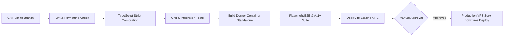

# SPPLPF Institutional Website & Administrative Dashboard
## Comprehensive Engineering Blueprint and Phased Implementation Plan

---

### Document Control & Metadata

| Attribute | Specification |
|:---|:---|
| **Document ID** | SPPLPF-ENG-PLAN-V1.5 |
| **Project Title** | Institutional Website & Admin Content Management Platform |
| **Organization (Arabic)** | مؤسسة حماية القانون وتعزيز السلم الاجتماعي |
| **Organization Acronym** | SPPLPF |
| **Document Classification** | Master Engineering Architecture & Implementation Plan |
| **Authors** | Lead Solution Architect, Lead Frontend Architect, Lead Backend Architect, Database Architect, UI/UX Systems Designer, DevSecOps Specialist, QA/Test Automation Lead, Technical Project Manager |
| **Status** | Final Architecture Plan Candidate (Approved for Implementation Handoff) |
| **Creation Date** | October 2026 |
| **Last Revised** | 19 October 2026 (V1.5 — Final Architecture Plan Closure Pass) |
| **Revision Summary** | V1.5 Final Plan Closure: Re-evaluated and pinned active upstream container image digests from Docker Hub registry (PostgreSQL 17.11-alpine, Valkey 8.0.11-alpine with 8.0 vs 8.1 compatibility analysis, NGINX 1.30.6-alpine, and Redis 7.4.11-alpine fallback); reconciled Phase 05 static toolchain gate (TASK-001a) and Phase 06 container datastore gate (TASK-005a), eliminating circular Compose dependencies; corrected Valkey status under OQ-007 to a provisional recommendation pending project owner confirmation while keeping production deployment strictly gated on legal/donor compliance; clarified kickoff checklist to scaffold package.json and establish lockfile before npm install. |
| **Target Implementation Environment** | Standalone Linux VPS (Ubuntu 24.04 LTS), Docker Engine 29+, PostgreSQL 17, Node.js 24 LTS |
| **Primary Reference Source** | SPPLPF Institutional Profile (22-Page Extracted Dossier & Visual Archive) |

---

## 1. Executive Summary

### 1.1 Project Overview & Strategic Purpose
The **Peace, Protection and Law Foundation** (مؤسسة حماية القانون وتعزيز السلم الاجتماعي - **SPPLPF**) requires a state-of-the-art, secure, highly performant, and fully bilingual (Arabic-first with complete English localization) digital platform. The platform serves two primary, integrated missions:
1. **Public Institutional Portal:** Projecting the organization's mission, governance, field interventions, mediation successes, legal advocacy, publications, and strategic partnerships to local communities, international donors (including the European Union, the Kingdom of the Netherlands, and UN agencies), civil society coalitions, and governmental authorities.
2. **Administrative Content Workspace (Admin Dashboard):** Providing a hardened, role-governed, auditable operational hub for editorial staff, field officers, reviewers, and executive directors to draft, translate, review, approve, schedule, publish, and archive institutional communications, project milestones, media assets, research publications, and community inquiries.

### 1.2 Organizational Background & Context
Founded in Yemen (with foundational peacebuilding initiatives dating back to December 2016 and formalized field operations expanding across 2021–2026), SPPLPF operates in an exceptionally demanding socio-political and humanitarian environment. Following operational shifts and security considerations in Sana'a, the organization strategically established its **Head Office & Core Operational Hub in Taiz Governorate** (Al-Morur Street, Taiz), while maintaining a vital **Branch Office in Marib Governorate** and a specialized task presence in **Sana'a** for track-two mediation and humanitarian legal coordination. SPPLPF holds official legal permits covering Taiz, Marib, neighboring southern governorates (including Lahj), and national-level mandates for neutral mediation.

The organization's interventions center on:
- Strengthening local mediation and tribal/community reconciliation mechanisms.
- Prisoner exchange facilitation and recovery of remains across conflicting frontlines (having successfully facilitated 19 bilateral agreements and 57 exchange operations across 10 governorates).
- Youth rehabilitation and societal reintegration for former combatants.
- Empowerment of women and youth in political participation and local decision-making.
- Governance, rule of law, anti-corruption, and institutional oversight in civil society and law enforcement agencies.
- Humanitarian legal defense, civilian protection at checkpoints, and specialized healthcare advocacy.

### 1.3 Core Engineering Principles
The proposed engineering blueprint enforces non-negotiable software engineering disciplines:
- **Security & Privacy by Design:** The platform operates in a sensitive geopolitical theater. Hardened session management, zero client-side privilege presumption, backend-enforced role-based access control (RBAC), strict input sanitization, automated audit logging, encrypted data at rest and in transit, and intentional exclusion of sensitive legal case records protect staff, beneficiaries, and institutional integrity.
- **RTL-First Bilingual Architecture:** Arabic is the native language of operation and must never be treated as a localized afterthought. The design system, typographic hierarchy, layout engine, data models, and API responses treat Arabic (Right-to-Left) and English (Left-to-Right) as first-class, symmetrical citizens.
- **Modular Monolith Architecture:** Premature microservices introduce distributed transaction failures, network latency, devops friction, and operational fragility. The platform is architected as a cohesive, modular monolith built on Next.js 16 LTS (App Router, React 19, TypeScript Strict Mode) backed by PostgreSQL 17 and Prisma ORM. Strict module boundaries, clear domain services, decoupled repository patterns, and shared Zod schemas allow future microservice extraction if ever justified, while delivering maximum performance, low operational cost, and zero API mismatch today.
- **Deterministic Quality & Zero-Assumed-Knowledge Implementation:** Every data entity, API endpoint, UI component, CSS token, Git convention, test suite, and CI/CD stage is explicitly specified with concrete schemas, acceptance criteria, and failure recovery protocols.

---

## 2. Source Analysis and Content Inventory

### 2.1 Complete Institutional Profile Audit
The 22-page institutional profile (`بروفايل.pdf`) was analyzed page by page across both raw text streams and high-resolution photographic and graphic scans. The document details institutional activities between 2016 and 2026.

```
+---------------------------------------------------------------------------------------------------+
| PAGE-BY-PAGE SOURCE DOSSIER BREAKDOWN                                                             |
+---------------------------------------------------------------------------------------------------+
| Page 01: Cover & Official Emblem (Scales of Justice shield, olive wreath, bilingual emblem text)  |
| Page 02: "Who We Are" statement (Institutional commitment, human rights, sustainable development) |
| Page 03: Executive / International Bilateral Dialogue Photographic Archive                        |
| Page 04: Vision 2030 Statement & Formal Mission Statement                                         |
| Page 05: Field Workshop Photo: "Workshop to Prepare Mediation Plan in Economic File - Gas File"   |
| Page 06: Institutional Values Triad (Diversity, Equality, Neutrality)                             |
| Page 07: Project Training Photo: "Enhancing Local Mediation in Yemen" (EU & Resonate! Partnered)  |
| Page 08: The 5 Strategic Goals Diagram (Empowerment, Decision-Making, Governance, Livelihoods)    |
| Page 09: Operational Presence, Office Network & Geographic Scope (Taiz Hub, Marib, Sana'a, Lahj)   |
| Page 10: Institutional Timeline & Key Historical Milestones (Dec 2016 through 2025/2026)          |
| Page 11: Quantitative Impact Dossier & 8 Core Success Story Indicators                            |
| Page 12: High-Level Diplomatic Engagement: EU & Netherlands Ambassadors Meeting in Marib         |
| Page 13: Rule of Law Symposium: Strengthening Legal Oversight & Transparency (Judges/Prosecutors)  |
| Page 14: Civil Society Governance Workshop: Oversight & Transparency in Taiz CSOs (12 leaders)    |
| Page 15: Security Sector Capacity Building: Digital Security for Army & Police Officers in Taiz   |
| Page 16: Local Mediation Launch: Community Reconciliation Committee Assembly in Marib (EU/Resonate)|
| Page 17: Regional Experience-Sharing Conference in Amman, Jordan (Yemen-Iraq CSO Exchange 2026)   |
| Page 18: International Study Visit: Clingendael Institute of International Relations (The Hague)  |
| Page 19: Priority Thematic Issues (Women's marginalization at 70%, Youth conflict, Public assets)  |
| Page 20: Institutional Strengths Matrix (Targeting, Efficient Team, Strategic Partnerships, Track) |
| Page 21: High-Level Advocacy Photographic Archive: International Criminal Court (ICC, The Hague)   |
| Page 22: Back Cover, Leadership Graduation Photo, Physical Office Address & Official Contact Info |
+---------------------------------------------------------------------------------------------------+
```

### 2.2 Fact Extraction & Verification Matrix

> [!WARNING]
> **Source extraction is not organizational approval.** All facts below were extracted from the institutional profile PDF (`بروفايل.pdf`). External records (such as official Ministry of Social Affairs and Labor registration certificates or legal gazette filings) were not provided in the project repository dossier. The "Verification Status" column reflects *consistency within the source profile dossier*, not formal organizational approval for public website publication. Before any content is published on the live website, the organization must formally review and approve the specific text, translations, and data values through a content sign-off process (see OQ-006 in §3.3).

| Category | Source-Derived Fact (Profile Extraction) | Evidence Location | Verification Status | Platform Mapping |
|:---|:---|:---|:---|:---|
| **Arabic Legal Name** | مؤسسة حماية القانون وتعزيز السلم الاجتماعي | Pages 1, 5, 12, 13, 16, 22 | 📋 Profile Dossier Baseline — Pending Formal Org Sign-Off (OQ-006) (Consistent across profile pages; formal government registration certificate not provided in repo dossier) | Site Header, Footer, Legal Notices, SEO metadata |
| **English Acronym** | SPPLPF | Pages 1, 5, 9, 17, 22 | 📋 Profile Dossier Baseline — Pending Formal Org Sign-Off (OQ-006) (Consistent across profile pages) | Brand identity, URL domain (`spplpf.org`), code namespace |
| **English Official Name** | *Inconsistent across source dossier (10 variants)* | Pages 1, 2, 4, 5, 6, 9, 12, 16, 17 | ❌ **Flagged Inconsistency — Awaiting Org Decision (OQ-001)** | Requires formal organizational sign-off (ADR-009) |
| **Vision Statement** | "Towards a society characterized by peace and justice, where women and youth play an active role in decision-making and sustainable development in Yemen by 2030." | Page 4 | 📋 Extracted — Pending Org Approval | Home Hero, About Page, Strategic Vision Section |
| **Mission Statement** | "Himaaya Organization for Law and Social Peace strives to achieve a society rooted in peace and justice by empowering women and youth and enhancing their active participation in decision-making..." | Page 4 | 📋 Extracted — Pending Org Approval (uses an English name variant that may conflict with OQ-001) | Home Mission Card, About Page, Donor Briefings |
| **Institutional Values** | **Diversity** (embracing differences), **Equality** (respecting every person, gender equality), **Neutrality** (non-governmental, non-profit, non-political, non-sectarian) | Page 6 | 📋 Extracted — Pending Org Approval | Values Carousel, Governance Page, Code of Conduct |
| **5 Strategic Goals** | 1. Empower women & youth socially, politically, economically<br>2. Enhance women & youth decision-making role<br>3. Improve governance & institutional development<br>4. Improve livelihoods for vulnerable groups<br>5. Strengthen institutional capacities | Page 8 | 📋 Extracted — Pending Org Approval | Interactive Goals Grid, Strategic Plan Section |
| **Headquarters & Hub** | Al-Morur Street, Taiz, Yemen. Command center for core operations, planning, high-budget programs | Pages 9, 22 | 📋 Extracted — Pending Org Approval | Contact Page, Interactive Presence Map, Footer |
| **Branch Office** | Marib Governorate (covering all districts; IDP and host community focus) | Page 9 | 📋 Extracted — Pending Org Approval | Presence Map, Marib Intervention Page |
| **Specialized Office** | Sana'a Governorate (restricted core team for neutral track-two mediation and legal advocacy) | Page 9 | 📋 Extracted — Pending Org Approval | Presence Map, Specialized Mandates Note |
| **Operational Coverage** | Taiz, Marib, Lahj, and Northern Governorates under national permit | Page 9 | 📋 Extracted — Pending Org Approval | Geographic Footprint Visualizer |
| **Quantitative Impact** | - 19 prisoner exchange & body recovery agreements signed (10 governorates)<br>- 57 prisoner/detainee exchange operations conducted<br>- 100 conflict-involved youth rehabilitated<br>- 20 peacebuilders empowered in media/peace<br>- Neutral healthcare access secured in conflict zones | Page 11 | 📋 Extracted — Pending Org Approval (numbers may have changed since profile publication) | Home Impact Counter, Success Stories Page, Donor Impact Page |
| **Key Milestones** | - Dec 2016: Youth as Pioneers of Peace<br>- Jan 2021: First Epilepsy Assessment & Treatment Center<br>- Mar-Sep 2022: Local Mediation Support Project<br>- Nov 2022-Jun 2023: Youth Armed Conflict Reintegration<br>- Dec 2022-Jun 2023: Prisoner Exchange & Remains Recovery<br>- Jun-Sep 2024: Economic File Support & Mediation (Gas File)<br>- 2025: Strengthening Local Mediation in Yemen (EU-funded)<br>- 2025: Local Authority & Taiz Axis Transparency Project<br>- 2025: Amplifying the Voices of Survivors Project | Pages 5, 10, 16 | 📋 Extracted — Pending Org Approval | Interactive Historical Timeline Component, Programs Archive |
| **Key Partnerships** | - European Union Delegation to Yemen (Donor/Partner)<br>- Kingdom of the Netherlands (Diplomatic Partner)<br>- Resonate! Yemen (Primary Strategic Implementing Partner)<br>- Regional/International CSOs: PAX, Tech4Peace, IAA | Pages 7, 12, 16, 17 | 📋 Extracted — Pending Org Approval | Institutional Partners Grid, Project Attribution Badges |
| **Contact Data** | - Address: Al-Morur Street, Taiz, Yemen<br>- Landline: +967 04 254 490<br>- Official Web: www.spplpf.org<br>- Official Email: info@spplpf.org | Page 22 | 📋 Extracted — Pending Org Approval | Header Quick Contact, Contact Page, Email Dispatchers |

### 2.3 Organizational Naming Analysis & Discrepancy Log
The source document displays substantial variation in the organization's English nomenclature. To preserve institutional integrity, these variations are logged below and classified as an open architectural decision requiring executive approval:

```
+---------------------------------------------------------------------------------------------------------+
| ENGLISH NAMING AUDIT LOG & FREQUENCY                                                                   |
+---------------------------------------------------------------------------------------------------------+
| Variant 1: "Social Peace Promotion & Legal Protection"                                [Cover & Logo P.1]|
| Variant 2: "Himaaya Organization"                                                     [Who We Are P.2]  |
| Variant 3: "Himaaya Organization for Law and Social Peace"                            [Mission P.4]     |
| Variant 4: "Peace Promotion and Legal Protection Foundation (SPPLPF)"                 [Banner Photo P.5]|
| Variant 5: "Himaya"                                                                   [Values P.6]      |
| Variant 6: "Peace, Protection and Law Foundation (SPPLPF)"                            [Operations P.9]  |
| Variant 7: "Foundation for the Protection of Law and Strengthening Social Peace"      [Diplomacy P.12]  |
| Variant 8: "Foundation for the Protection of Law and Strengthening of Social Peace"   [Mediation P.16]  |
| Variant 9: "Social peace promotion and lagel protection foundation" (typo in source)  [Regional P.17]   |
| Variant 10: Official Domain / Acronym: "SPPLPF" (spplpf.org)                          [Emblem & Back]   |
+---------------------------------------------------------------------------------------------------------+
```
**Engineering Resolution:** 
- The Arabic name remains immutable: **مؤسسة حماية القانون وتعزيز السلم الاجتماعي**.
- The recommended English primary name is: **Social Peace Promotion and Legal Protection Foundation (SPPLPF)**, which aligns directly with the official acronym and registered domain `www.spplpf.org`.
- A fallback configuration is isolated within the platform's `site_settings` database entity to allow instant, global updating upon receipt of formal board certification without requiring code redeployment.

### 2.4 Content Classification & Public Readiness Assessment

```
+---------------------------------------------------------------------------------------------------------+
| CONTENT GOVERNANCE & SENSITIVITY CLASSIFICATION                                                         |
+---------------------------------------------------------------------------------------------------------+
| [GREEN: Public Domain / Immediate Publication]                                                          |
| - Verified institutional mission, vision, values, and organizational goals.                             |
| - High-level project overviews (Local Mediation, Economic Gas File, Taiz Transparency).                |
| - Aggregated public statistics (19 agreements, 57 exchanges, 100 rehabilitated youth).                  |
| - Published press releases (EU Ambassador meetings, regional workshops, public symposiums).             |
| - Official office contact numbers, public inquiries email, and Taiz/Marib geographic presence.         |
|                                                                                                         |
| [AMBER: Editorial Review & Institutional Approval Required Prior to Web Ingestion]                     |
| - Full names and identifiable photographs of local mediators, tribal arbiters, and field monitors.       |
| - Specific district-level intervention routes in contested frontline zones.                             |
| - Detailed text of prisoner exchange agreements and bilateral negotiation protocols.                   |
| - International donor grant sizes, bilateral contract agreements, and financial audit reports.          |
|                                                                                                         |
| [RED: Strictly Out of Scope / Excluded from Public Web & Admin Database]                                |
| - Names, contact records, or identification data of detainees, prisoners, or recovered remains.         |
| - Personal case-management files of rehabilitated youth or psychiatric epilepsy patients.               |
| - Real-time security movement logs or unannounced travel itineraries of executive leadership.           |
+---------------------------------------------------------------------------------------------------------+
```

---

## 3. Assumptions, Constraints, and Open Questions

### 3.1 Technical & Infrastructure Assumptions
- **Hosting Topology:** The system will be deployed to an enterprise-grade virtual private server (VPS) running Ubuntu 24.04 LTS (minimum 4 vCPUs, 8 GB RAM, 100 GB NVMe SSD) provisioned in a high-reputation, neutral European data center (e.g., Frankfurt/Falkenstein) to guarantee maximum uptime, low international latency, and compliance with data sovereignty best practices.
- **Network Bandwidth & Compute:** While production compute is robust, frontend assets must be radically optimized (compressed WebP/AVIF, HTTP/2 multiplexing, aggressive asset caching) because end users in Yemen frequently experience constrained 3G/4G bandwidth (256 kbps - 1 Mbps) and high packet loss.
- **Email Infrastructure:** Outbound transactional emails (admin notifications, contact form confirmations) will route via a reputable SMTP relay (e.g., Postmark or Amazon SES) with strict SPF, DKIM, and DMARC enforcement.

### 3.2 Operating Constraints in Yemen
- **Intermittent Power & Connectivity:** Admin staff in Taiz and Marib frequently experience localized power outages and intermittent fiber/wireless drops. The administrative dashboard must provide client-side auto-saving of form drafts to browser `localStorage` and clear offline/reconnection status toasts.
- **Strict Political Neutrality & Defense from Cyber Threat:** Given the polarized operating environment, the platform must present zero political alignment, maintain strict HTTPS (TLS 1.3 only), enforce Cloudflare or Nginx reverse-proxy rate limiting against DDoS attacks, and prevent server fingerprinting.

### 3.3 Open Questions & Institutional Decision Register

To eliminate ambiguity while preventing unauthorized assumptions, the following register defines the authoritative set of institutional questions (**OQ-001 through OQ-008**). Each decision defines the exact question, recommended engineering default, authorized decision-maker, blocked component, decoupled progress path, and required evidence of approval.

| ID & Domain | What Must Be Decided | Recommended Engineering Default | Authorized Decision-Maker | Blocked Component / Release Decision | Decoupled Progress (Can Proceed Meanwhile) | Required Evidence of Approval |
|:---|:---|:---|:---|:---|:---|:---|
| **OQ-001**<br>Institutional Branding | Formal English legal name and acronym representation across all public interfaces and legal metadata. | Adopt **"Social Peace Promotion and Legal Protection Foundation (SPPLPF)"** (مؤسسة حماية القانون وتعزيز السلم الاجتماعي) as a **PROVISIONAL RECOMMENDATION** pending formal Board confirmation. | Executive Board / Executive Director | Public footer legal copyright notice, English metadata title tags, international press release header templates. | Entire platform codebase, CMS, database schema, Arabic pages, and UI components proceed independently. | Executive Board resolution or signed organizational charter. |
| **OQ-002**<br>Field Protection & Safety | Publication and consent policy regarding identifiable photographs and names of local community mediators and tribal arbiters in contested frontline zones. | Enforce strict facial blurring and name pseudonymization by default. Unblurred media permitted **only** upon submission of a signed written informed consent checklist. | Security & Legal Officer / Executive Management | Public release of media galleries and news articles containing community peacemakers in frontline districts. | Media asset manager module, upload/crop pipeline, article drafting, and private admin preview proceed independently. | Formally approved and signed Field Media & Peacemaker Protection Policy. |
| **OQ-003**<br>Financial Governance | Public disclosure policy for annual financial statements, external donor audit reports, and bilateral grant amounts. | The publications and research module supports PDF upload and metadata indexing, but financial statements and donor grant sizes remain in **`DRAFT` / unlisted status** until explicitly authorized. | Financial Director / Executive Director | Public download links and visibility of audited financial statements on `/publications`. | Publications module development, PDF streaming gateway, search indexing, and report drafting proceed independently. | Signed Financial Disclosure Authorization memo from the Financial Director. |
| **OQ-004**<br>Editorial & Leadership Naming | Standardized English spelling and professional titles for executive leadership and Board members. | Adopt **"Eng. Hothifa Hassan"** (Programs and Projects Manager) as a **PROVISIONAL RECOMMENDATION** per profile page 17, and formal transliterations for Board members. | Executive Management / Board Secretary | Public About page leadership cards, governance bios, and author attribution strings. | Team member entity schema, admin user management, and team directory UI components proceed independently. | Written approval of leadership roster from Executive Management. |
| **OQ-005**<br>Public Engagement | Policy regarding public reader comments on news articles, publications, and press releases. | Public commenting remains **strictly disabled**. Unidirectional institutional publishing; public feedback routed exclusively through the protected contact form (§4.1, FR-009). | Communications Officer / Executive Director | Interactive comment threads, public user accounts, and community discussion boards (if requested). | News and insights module, rich text rendering, contact form dispatcher, and inquiry management proceed independently. | Written confirmation of Public Engagement & Moderation Policy. |
| **OQ-006**<br>Content & Registration Baseline | Formal verification of profile-extracted baseline facts, historical timeline milestones, and official government registration certificates. | All profile-extracted seed content (§2.2) is loaded into the database as **`DRAFT` only**. The engineering team will not publish seed data without formal editorial review. Government registration certificate documents remain pending from the organization. | Executive Director / Communications Officer | Public publication of pre-seeded institutional milestones, historical narratives, and legal registration numbers. | Database migrations, seed scripts, CMS publishing workflow, test suites, and staging deployment proceed independently. | Signed Content & Registration Verification Sign-Off by Executive Director. |
| **OQ-007**<br>Cache Datastore & Donor Licensing | Selection of production cache datastore: **Valkey 8.x** (BSD-3-Clause) vs. **Redis 8.x** (RSALv2, SSPLv1, AGPLv3 tri-license) under donor procurement rules (EU, Netherlands MFA, UN). | **Provisional Recommendation Pending Owner Confirmation:** Engineering recommends **Valkey 8.0.11-alpine** as the provisional datastore for local development and testing, pending confirmation by the project owner. **Production Deployment Blocked:** Production rollout is strictly gated until Legal Counsel and the Donor Compliance Officer formally review grant terms and record their decision on Valkey or mandate Redis (`redis:7.4.11-alpine` via `docker-compose.redis-fallback.yml`). | Legal Counsel / Donor Compliance Officer | Production deployment in Phase 20 and final donor grant audit reporting. | All foundational development across Phases 1 through 18 proceeds immediately using the standard Redis wire protocol (`ioredis`). | Formal written sign-off from Legal Counsel and Donor Compliance Officer prior to Phase 19/20. |
| **OQ-008**<br>Bilingual Editorial Publication Policy | Publication gate policy when an Arabic article is approved but its English translation is delayed or pending. | Publication gate requires: (a) content in `APPROVED` status, and (b) **Arabic translation approved**. English translation is optional at publication time; if absent, system renders Arabic text with an accessible "Translation pending" banner. Global `publishedAt` on `ContentItem`. | Communications Officer / Executive Director | Strict dual-language simultaneous publishing requirement (if ever mandated). | Entire CMS editorial workflow, translation editor, multi-locale routing, and frontend rendering proceed independently. | Written editorial workflow approval from Communications Officer. |

#### 3.3.1 Register Historical Reconciliation & Supplementary Guidelines
- **Historical Reconciliation Note:** In earlier preliminary audit notes (Pass 4), temporary references to "Dispute Case Resolution Metrics", "Donor Logo Co-Branding Rights", and "Executive Board Biographies" were informally logged. To maintain strict traceability, these items are formally reconciled as follows:
  - *Dispute Resolution Metrics:* Governed under §4.1 (FR-007 Success Stories) and OQ-002 (Peacemaker Safety & Anonymization).
  - *Donor Logo Co-Branding Rights:* Governed under §4.1 (FR-004 Programs) and international partner contract terms.
  - *Executive Board Biographies:* Formally tracked under **OQ-004** (Leadership Naming & Governance).
- **Core Principles Governing Institutional Decisions:**
  1. **Decoupled Foundational Engineering:** Foundational technical development—including monorepo setup, Prisma ORM schema migrations, Next.js routing, design tokens, UI components, authentication, and testing—can and must proceed immediately without waiting for institutional resolutions.
  2. **Draft-Only Ingestion of Profile Content:** In accordance with OQ-006, all narrative content, statistics, and milestones derived from the 22-page dossier are ingested in `DRAFT` status. No profile fact will be publicly released without explicit editorial sign-off.
  3. **Protection of Sensitive Field Data:** In accordance with institutional safety mandates (OQ-002), names, contact details, and photographs of community mediators, local arbiters, and conflict-affected beneficiaries in frontline governorates (Taiz, Marib, Sana'a) must never be published without verified written consent.
  4. **No Usurpation of Institutional Authority:** The engineering team establishes dependable defaults but will not silently finalize legal titles, donor licensing, or governance bios without signed authorization.

---

## 4. Functional## 4. Functional## 4. Functional and Non-Functional Requirements

### 4.1 Functional Requirements Specification

```
+--------------------------------------------------------------------------------------------------------+
| FUNCTIONAL REQUIREMENTS SUMMARY MATRIX                                                                 |
+--------------------------------------------------------------------------------------------------------+
| REQ-ID  | Module               | User Role         | Priority | Core Capability                        |
|:--------|:---------------------|:------------------|:---------|:---------------------------------------|
| FR-001  | I18N / Routing       | Public Visitor    | P0 (Must)| Instant bilingual switching (AR <-> EN)|
| FR-002  | Public Portal / Home | Public Visitor    | P0 (Must)| Display dynamic hero, mission, counters|
| FR-003  | About & Governance   | Public Visitor    | P0 (Must)| Render history, values, goals, board   |
| FR-004  | Programs & Projects  | Public Visitor    | P0 (Must)| Browse & filter programs by thematic area|
| FR-005  | News & Insights      | Public Visitor    | P0 (Must)| Read chronological news, articles, tags|
| FR-006  | Publications         | Public Visitor    | P0 (Must)| Search & download research reports/PDFs|
| FR-007  | Success Stories      | Public Visitor    | P1 (Should)| Showcase qualitative & metric impact   |
| FR-008  | Interactive Presence | Public Visitor    | P1 (Should)| Explore Taiz, Marib, Sana'a offices    |
| FR-009  | Contact Dispatcher   | Public Visitor    | P0 (Must)| Submit inquiries with anti-bot captcha |
| FR-010  | Global Search        | Public Visitor    | P1 (Should)| Full-text search across all content    |
| FR-011  | Admin Authentication | All Staff Roles   | P0 (Must)| Multi-factor, secure session login      |
| FR-012  | Granular RBAC        | System Admin      | P0 (Must)| Enforce role capabilities on every route|
| FR-013  | Content Workspace    | Editor / Author   | P0 (Must)| Draft bilingual articles with rich text|
| FR-014  | Editorial Lifecycle  | Reviewer/Publisher| P0 (Must)| Execute Draft->Review->Approve->Publish|
| FR-015  | Revision History     | Editor / Admin    | P1 (Should)| Track diffs & restore historical states|
| FR-016  | Media Asset Manager  | Media Manager     | P0 (Must)| Upload, crop, optimize, & organize imgs|
| FR-017  | Audit Logging        | Super Admin       | P0 (Must)| Immutable trail of all system actions  |
| FR-018  | Dynamic Site Config  | Super Admin       | P1 (Should)| Update global contacts, phone, branding |
+--------------------------------------------------------------------------------------------------------+
```

#### Detailed Functional Requirements
- **FR-001: Bilingual Routing & Layout:** The system must render all public pages in both Arabic (`/ar/...`) and English (`/en/...`). Changing the language switcher must immediately swap the HTML document direction (`dir="rtl"` vs `dir="ltr"`), swap typography, and preserve the relative semantic path without redirecting to the homepage.
- **FR-004: Programs & Interventions Catalog:** The system must present SPPLPF's programs categorized by thematic pillars: *Peacebuilding & Local Mediation*, *Rule of Law & Legal Oversight*, *Youth Empowerment & Reintegration*, *Women's Political Participation*, and *Vulnerable Community Support*. Each program must support rich media, donor partner logos, geographic tags, and progress indicators.
- **FR-006: Publications & Research Library:** The system must host institutional research papers, legal manuals, policy briefs, and annual reports. Each entry must record title, abstract, authors, publication date, file size, page count, language availability, and a secure download link with download count tracking.
- **FR-009: Protected Contact & Whistleblower/Inquiry Gateway:** The contact page must validate name, organization, email, subject category, and message body. The form must enforce an invisible honeypot and cryptographic rate limiting to eliminate automated spam without presenting inaccessible visual captchas to low-vision users. Submissions must be stored in the database and notify designated administrators via email.
- **FR-014: Multi-Stage Editorial Workflow:** Content cannot move directly from author creation to public release. The system must enforce a 4-state finite state machine: `DRAFT` $\to$ `IN_REVIEW` $\to$ `APPROVED` $\to$ `PUBLISHED`. Editors can create and edit drafts. Reviewers can approve or reject (with mandatory feedback notes). Only users with the `Publisher` or `Administrator` role can transition content to `PUBLISHED`.

### 4.2 Non-Functional Requirements Specification

```
+--------------------------------------------------------------------------------------------------------+
| NON-FUNCTIONAL PERFORMANCE & SECURITY METRICS                                                          |
+--------------------------------------------------------------------------------------------------------+
| Attribute          | Standard / Benchmark                | Verification Method                         |
|:-------------------|:------------------------------------|:--------------------------------------------|
| **LCP (Speed)**    | Largest Contentful Paint < 2.2s    | Lighthouse & Playwright automated audits    |
| **INP (Response)** | Interaction to Next Paint < 150ms  | Chrome UX Report & synthetic benchmarks     |
| **CLS (Stability)**| Cumulative Layout Shift < 0.05     | Web Vitals automated CI checks             |
| **Accessibility**  | WCAG 2.2 Level AA Full Conformance | Automated `axe-core` & manual screen-reader |
| **API Latency**    | 95th Percentile < 180ms             | K6 load testing against PostgreSQL         |
| **Availability**   | 99.9% Uptime (Excluding Maint.)     | External HTTP health monitor (Uptime Kuma)  |
| **Session Security**| OWASP ASVS Level 2 Compliance       | Automated ZAP scanning & static analysis    |
| **Password Hash**  | Argon2id (Memory: 64MB, Iter: 3)    | Cryptographic library configuration tests   |
| **Backup RPO**     | Recovery Point Objective < 24 Hours| Daily automated pg_dump with encryption     |
| **Backup RTO**     | Recovery Time Objective < 60 Mins  | Quarterly scripted disaster recovery drill  |
+--------------------------------------------------------------------------------------------------------+
```

---

## 5. Technology Stack Evaluation and Final Recommendation

### 5.1 Architecture Style Selection: Modular Monolith vs Distributed Microservices
- **Microservices Evaluation:** Introducing separate services for auth, content, media, search, and notifications requires distributed message brokers (Kafka/RabbitMQ), API gateways, Kubernetes orchestration, distributed tracing, complex multi-repo CI/CD, and eventual consistency handling. For an institutional team managing an NGO platform, this introduces catastrophic maintenance overhead with zero tangible throughput benefit.
- **Modular Monolith Decision:** A cohesive, modular monolith built in a single repository with strict internal boundaries. Each domain (Auth, Content, Media, Audit) is an isolated TypeScript module with its own service interfaces, repository classes, and validation schemas. The frontend and backend execute in a unified, type-safe Next.js runtime. If traffic ever demands independent scaling of specific background workers, the modular boundaries allow zero-friction extraction.

### 5.2 Comparative Technology Decision Matrices

```
+---------------------------------------------------------------------------------------------------------+
| COMPREHENSIVE TECHNOLOGY SELECTION MATRICES                                                             |
+---------------------------------------------------------------------------------------------------------+
| CATEGORY 1: FULL-STACK APPLICATION FRAMEWORK                                                            |
| Option               | Pros                                 | Cons                       | Verdict      |
|:---------------------|:-------------------------------------|:---------------------------|:-------------|
| **Next.js 16 (App)** | Active LTS, React 19 Server Comps,   | Requires migration from    | **SELECTED**  |
|                      | Cache Components, ISR/SSG for SEO,   | 15.x patterns for new      | (ADR-001)    |
|                      | unified TypeScript API routes        | Cache Components model     |              |
| Remix / React Router | Great nested routing & web standards | Smaller ecosystem than     | Rejected     |
|                      |                                      | Next.js, slower SSR caching|              |
| Vite SPA + NestJS    | Decoupled frontend/backend           | Poor SEO for public portal,| Rejected     |
|                      |                                      | double infrastructure cost |              |
+---------------------------------------------------------------------------------------------------------+
| CATEGORY 2: DATABASE & DATA ACCESS LAYER                                                                |
| Option               | Pros                                 | Cons                       | Verdict      |
|:---------------------|:-------------------------------------|:---------------------------|:-------------|
| **PostgreSQL 17**    | Rock-solid ACID, Arabic collation,   | Requires relational schema | **SELECTED**  |
|                      | native JSONB, `pg_trgm` full-text    | discipline (a plus)        | (ADR-004)    |
| MySQL 9.x            | Widely known, good performance       | Inferior full-text for     | Rejected     |
|                      |                                      | Arabic, weaker JSON index  |              |
| MongoDB 8            | Schema-less flexibility              | Zero referential integrity,| Rejected     |
|                      |                                      | unacceptable for audit/RBAC|              |
+---------------------------------------------------------------------------------------------------------+
| CATEGORY 3: ORM / DATA ACCESS                                                                           |
| Option               | Pros                                 | Cons                       | Verdict      |
|:---------------------|:-------------------------------------|:---------------------------|:-------------|
| **Prisma ORM**       | Declarative schema, automated typed  | Slight query engine binary  | **SELECTED**  |
|                      | migrations, unmatched DX & relations | size (negligible on VPS)   | (ADR-005)    |
| Drizzle ORM          | Lightweight SQL-like syntax          | Immature migration tooling | Rejected     |
| TypeORM              | Active Record / Data Mapper          | Aging codebase, flaky types| Rejected     |
+---------------------------------------------------------------------------------------------------------+
| CATEGORY 4: STYLING & DESIGN TOKENS                                                                     |
| Option               | Pros                                 | Cons                       | Verdict      |
|:---------------------|:-------------------------------------|:---------------------------|:-------------|
| **Vanilla CSS &**    | 100% standard CSS custom properties,  | Requires disciplined CSS   | **SELECTED**  |
| **CSS Modules**      | zero runtime overhead, native logical| architecture (BEM / tokens)| (ADR-003)    |
|                      | properties (`margin-inline-start`)   |                            |              |
| TailwindCSS          | Fast utility authoring               | Bloats HTML, cumbersome    | Rejected     |
|                      |                                      | directional RTL overrides  |              |
| Styled-Components    | Dynamic JS props styling             | Runtime CSS-in-JS penalty, | Rejected     |
|                      |                                      | broken in Server Components|              |
+---------------------------------------------------------------------------------------------------------+
```

### 5.3.1 Redis Versus Valkey Comparative Architecture & Selection Rationale

To support the resolution of **OQ-007**, the table below evaluates the architectural and operational implications of selecting **Valkey 8.x** versus **Redis 8.x / 7.x** for the SPPLPF production deployment:

| Architectural Dimension | Valkey 8.0.11-alpine (Recommended Default) | Redis 8.0.0 (Debian) | Redis 7.4.11-alpine (Alternative) |
|:---|:---|:---|:---|
| **Governing Entity** | Linux Foundation (Broad industry coalition) | Redis Ltd. (Commercial entity) | Redis Ltd. |
| **Licensing Framework** | **BSD-3-Clause** (Permissive Open Source, OSI-Approved) | **Tri-License:** RSALv2, SSPLv1, AGPLv3 (Copyleft / Source-Available) | RSALv2 / SSPLv1 Dual-License |
| **Donor Procurement Risk** | **Zero Risk:** Standard OSI permissive license satisfies EU, Dutch MFA, and UN procurement mandates. | **Moderate-High Risk:** AGPLv3 copyleft or SSPL commercial restrictions may trigger legal review under donor agreements. | **Moderate Risk:** Non-OSI source-available license may require donor waiver. |
| **Wire Protocol & API** | 100% binary and wire-protocol compatible with Redis 7.2/8.0 API. | Native Redis 8.0 API. | Native Redis 7.4 API. |
| **Client Library Support** | Compatible with standard `ioredis` / `redis` npm packages with zero code changes. | Compatible with standard `ioredis` / `redis` npm packages. | Compatible with standard `ioredis` / `redis` npm packages. |
| **Container Base Image** | Official lightweight **Alpine Linux** image available (`valkey/valkey:8.0.11-alpine`). | **No official Alpine image**; official images are Debian-based (~150MB larger attack surface). | Official Alpine image available (`redis:7.4.11-alpine`). |
| **Password & Config Setup** | Identical `requirepass` directive and `valkey-server` daemon. | Identical `requirepass` directive and `redis-server` daemon. | Identical `requirepass` directive and `redis-server` daemon. |
| **CLI & Healthcheck** | `valkey-cli` with identical commands (`valkey-cli ping`, `REDISCLI_AUTH`). | `redis-cli` with `REDISCLI_AUTH`. | `redis-cli` with `REDISCLI_AUTH`. |

**Engineering Recommendation & OQ-007 Operational Boundary:**
1. **Provisional Development Recommendation Pending Owner Confirmation:** To avoid stalling engineering, **Valkey 8.0.11-alpine** is recommended as the provisional cache datastore for local development and CI testing, pending project owner confirmation.
   - *Valkey 8.0 vs. 8.1 Comparison & Compatibility Rationale:* Evaluated Valkey 8.0.11-alpine (latest patch of the 8.0 LTS branch) against Valkey 8.1.10-alpine (`sha256:081c2f5cb575efc901aa80ff9cdbd1ec6a301682fd35e1ebb4b0990a4a4a8507`, latest patch of the 8.1 feature branch). Valkey 8.0.x is the foundational LTS release that guarantees 100% wire-protocol, command, and configuration parity with Redis 7.2.4 APIs used by standard Node.js client packages (`ioredis`). Valkey 8.1.x is a minor feature release that introduced multi-threaded I/O improvements and new replication commands, but does not provide additional benefits for single-node Redis caching in SPPLPF while introducing slight command variations and higher potential for client-driver edge cases. Therefore, upgrading minor versions to 8.1 is deliberately avoided at this stage to preserve backward compatibility, and 8.0.11-alpine is chosen as the fully patched, stable release.
2. **Technical Decoupling:** Application code in `lib/redis.ts` utilizes the standard `ioredis` client and standard Redis wire commands (`get`, `set`, `del`, `sadd`, `sismember`), meaning the codebase is 100% agnostic to whether Valkey or Redis runs in the container.
3. **Strict Production Decision Gate & Redis Fallback Runbook:** Production deployment (Phase 20) is **strictly blocked** until the organization's Legal Counsel and Donor Compliance Officer review grant conditions (EU, Netherlands MFA, UN) and formally record their sign-off on Valkey (BSD-3-Clause) or mandate Redis.
   - *Configuration Requirement:* Switching from Valkey to Redis cannot be achieved merely by modifying the container image line, because `docker-compose.yml` invokes daemon-specific binaries (`valkey-server` and `valkey-cli`). Official Redis images (`redis:7.4.11-alpine`) require `redis-server` and `redis-cli`.
   - *Zero Application Refactoring via Compose Override:* If Redis is formally mandated, the switch is executed with **zero application TypeScript code refactoring** by applying the verified Compose override file `docker-compose.redis-fallback.yml` (detailed in §19.2.4.1), which updates the image, command (`redis-server /tmp/redis.conf`), and healthcheck (`redis-cli ping`). Application code in `lib/redis.ts` utilizes the standard Redis wire protocol (`ioredis`) and remains 100% unchanged.

### 5.3 Final Technology### 5.3 Final Technology### 5.3 Final Technology Stack Blueprint

```
+---------------------------------------------------------------------------------------------------+
| THE SPPLPF PRODUCTION TECHNOLOGY STACK                                                            |
+---------------------------------------------------------------------------------------------------+
| [FRONTEND LAYER]                                                                                  |
| - Runtime / Framework: Next.js 16.4.2 (React 19.2.9, TypeScript 5.8.2 Strict Mode; pinned 5.7.3 fallback) |
| - Rendering Paradigms: Static Site Generation (SSG) + Incremental Static Regeneration (ISR)        |
|   for Public Pages; Dynamic Client-Side SPA Rendering for Protected Admin Dashboard               |
| - Design Tokens & Styling: Vanilla CSS Modules + Native CSS Custom Properties (Light/Dark Tokens) |
| - UI Component Primitives: Radix UI Primitives (Accessible, unstyled modals, dropdowns, tabs)     |
| - Typography: Cairo & IBM Plex Sans Arabic (Arabic); Inter (English)                              |
| - Client State: TanStack Query v5 (Data caching/mutations), Zustand (Dashboard UI state)          |
|                                                                                                   |
| [BACKEND & API LAYER]                                                                             |
| - Execution Runtime: Node.js 24 LTS (Active Long-Term Support)                                    |
| - API Architecture: RESTful JSON Architecture via Next.js Route Handlers (`/api/v1/...`)         |
| - Schema Validation: Zod 4+ (Shared universal schemas between frontend forms and API routes)      |
| - Authentication: Custom Secure Session Engine using HttpOnly, SameSite=Strict, Secure Cookies,    |
|   backed by Argon2id password hashing and Redis session invalidation                              |
| - Authorization: Granular RBAC + PBAC Policy Enforcement Engine                                   |
|                                                                                                   |
| [DATA & PERSISTENCE LAYER]                                                                        |
| - Primary Database: PostgreSQL 17.11-alpine (pinned SHA256 digest)                                 |
| - Data Access / ORM: Prisma ORM 7.1.0 with prisma/config, custom client output, and @prisma/adapter-pg|
| - Search Engine: PostgreSQL Full-Text Search with `pg_trgm` and localized text search dictionaries|
| - In-Memory Cache: Valkey 8.0.11-alpine (or Redis 7.4.11-alpine; isolated DB 0 sessions / DB 1 cache)|
|                                                                                                   |
| [STORAGE & MEDIA PIPELINE]                                                                        |
| - Media Processor: Sharp (High-performance native image compression, WebP/AVIF generation)       |
| - Storage Adapter: Encrypted Local Filesystem with S3-compatible cloud storage abstraction layer  |
|                                                                                                   |
| [OPERATIONS, TESTING & INFRASTRUCTURE]                                                           |
| - Test Tooling: Vitest (Unit/Integration), Playwright (E2E & Visual Regression), axe-core (A11y)  |
| - Containerization: Docker Engine 29+ with multi-stage standalone output optimization             |
| - Reverse Proxy: Nginx 1.30.6-alpine (pinned SHA256 digest, TLS 1.3, rate-limiting)               |
| - CI/CD Pipeline: GitHub Actions (Lint -> Typecheck -> Unit -> Integration -> E2E -> Docker Deploy|
+---------------------------------------------------------------------------------------------------+
```

---

## 6. System Architecture and Architecture Diagrams

### 6.1 System Architecture Overview
The platform employs a layered, multi-tier architecture partitioned across clear security and responsibility boundaries. Incoming HTTPS traffic terminates at the Nginx reverse proxy, which enforces TLS certificates, security headers, rate limiting, and static file offloading. Authenticated administrative operations and public page requests are serviced by the Next.js application container, which interacts with PostgreSQL through connection pooling and Redis for transient state.

### 6.2 Master System Architecture Diagram

```mermaid
graph TB
    subgraph Client_Tiers [Client Tier & Network Edge]
        PublicUser["Public Web Visitor (Desktop / Mobile / Low-Bandwidth)"]
        AdminUser["Institutional Staff (Editor, Reviewer, Publisher, Admin)"]
        Cloudflare["Edge CDN / DNS / DDoS Shield"]
    end

    subgraph Reverse_Proxy_Tier [Ingress & Reverse Proxy]
        Nginx["Nginx Reverse Proxy (Port 443 TLS 1.3 / Port 80 Redirect)"]
        SecHeaders["Security Headers (CSP, HSTS, X-Frame, Permissions)"]
        RateLimiter["Connection & Request Rate Limiter"]
    end

    subgraph Application_Tier [Next.js 16 Application Container (Node.js 24 LTS)]
        Router["Next.js App Router (Bilingual Routing Engine: /ar, /en)"]
        
        subgraph Public_Engine [Public Rendering Engine]
            RSC["React Server Components (ISR / SSG Caching)"]
            PublicPages["Institutional Pages (Home, About, Projects, News, Contact)"]
        end

        subgraph Admin_Engine [Admin Dashboard Engine]
            AdminAuth["Auth Guard & Session Resolver (HttpOnly Cookie)"]
            RBAC["RBAC & Permission Enforcement Engine"]
            DashboardUI["Admin Single-Page Workspace (React 19 Client Tree)"]
        end

        subgraph Service_Domain_Layer [Core Modular Services]
            AuthService["Authentication & User Service"]
            ContentService["Content & Editorial Workflow Service"]
            ProgramService["Programs & Interventions Service"]
            PublicationService["Research & Publications Service"]
            MediaService["Media Pipeline & Storage Service"]
            SearchService["Bilingual Full-Text Search Service"]
            AuditService["Immutable Audit Logging Service"]
        end

        subgraph Validation_Tier [Contract Validation]
            ZodSchemas["Zod Schemas (DTO Validation & Sanitization)"]
        end
    end

    subgraph Data_Storage_Tier [Persistence & Infrastructure Layer]
        PrismaClient["Prisma ORM Client (Connection Pooler)"]
        Postgres[("PostgreSQL 17 Relational Database")]
        RedisDB[("Redis 8.0 In-Memory Cache & Session Store")]
        MediaDisk["Secure Media Storage (Encrypted NVMe Local / S3 Ready)"]
    end

    PublicUser --> Cloudflare
    AdminUser --> Cloudflare
    Cloudflare --> Nginx
    Nginx --> SecHeaders
    SecHeaders --> RateLimiter
    RateLimiter --> Router

    Router --> Public_Engine
    Router --> Admin_Engine

    PublicPages --> Service_Domain_Layer
    DashboardUI --> AdminAuth
    AdminAuth --> RBAC
    RBAC --> Service_Domain_Layer

    Service_Domain_Layer --> ZodSchemas
    Service_Domain_Layer --> PrismaClient
    Service_Domain_Layer --> MediaService
    Service_Domain_Layer --> RedisDB

    MediaService --> MediaDisk
    PrismaClient --> Postgres
    SearchService --> Postgres
    AuditService --> Postgres
```

### 6.3 Sequence Diagram: Multi-Stage Editorial Workflow Execution

```mermaid
sequenceDiagram
    autonumber
    actor Editor as Field Editor
    actor Reviewer as Program Reviewer
    actor Publisher as Executive Publisher
    participant API as Next.js API Layer (/api/v1/content)
    participant Auth as Auth & RBAC Guard
    participant Workflow as Editorial Workflow Service
    participant DB as PostgreSQL 17
    participant Audit as Audit Logger

    %% Step 1: Draft Creation
    Editor->>API: POST /api/v1/content (Draft Payload, Bilingual Text)
    API->>Auth: Validate Session & Permission ('content.create')
    Auth-->>API: Authorized (Role: Editor)
    API->>Workflow: CreateContentItem(status: 'DRAFT')
    Workflow->>DB: INSERT INTO content_items, content_translations
    DB-->>Workflow: Created (ID: CNT-101, Status: DRAFT)
    Workflow->>Audit: LogAction(USER_ID, 'CONTENT_DRAFT_CREATED', CNT-101)
    Workflow-->>API: 201 Created (CNT-101)
    API-->>Editor: Draft Saved Successfully

    %% Step 2: Submit for Review
    Editor->>API: POST /api/v1/content/CNT-101/submit-review
    API->>Auth: Validate Permission ('content.submit')
    API->>Workflow: TransitionState(CNT-101, 'IN_REVIEW')
    Workflow->>DB: UPDATE content_items SET status = 'IN_REVIEW'
    Workflow->>Audit: LogAction(USER_ID, 'CONTENT_SUBMITTED_REVIEW', CNT-101)
    API-->>Editor: 200 OK (Status: IN_REVIEW)

    %% Step 3: Reviewer Approval
    Reviewer->>API: POST /api/v1/content/CNT-101/approve
    API->>Auth: Validate Permission ('content.review')
    Auth-->>API: Authorized (Role: Reviewer)
    API->>Workflow: TransitionState(CNT-101, 'APPROVED')
    Workflow->>DB: UPDATE content_items SET status = 'APPROVED'
    Workflow->>Audit: LogAction(REVIEWER_ID, 'CONTENT_APPROVED', CNT-101)
    API-->>Reviewer: 200 OK (Status: APPROVED)

    %% Step 4: Final Publishing
    Publisher->>API: POST /api/v1/content/CNT-101/publish
    API->>Auth: Validate Permission ('content.publish')
    Auth-->>API: Authorized (Role: Publisher)
    API->>Workflow: PublishContent(CNT-101)
    Note over Workflow,DB: Validates Arabic translation is approved (mandatory gate). English translation optional per OQ-008; if absent, missing-English fallback is applied.
    Workflow->>DB: BEGIN TX: UPDATE content_items (status: 'PUBLISHED', published_at: NOW()); INSERT INTO cache_invalidation_outbox; COMMIT
    Workflow->>Audit: LogAction(PUBLISHER_ID, 'CONTENT_PUBLISHED', CNT-101)
    API-->>Publisher: 200 OK (Published to Public Website; Invalidation Queued)
```

---

## 7. Information Architecture and Website Sitemap

### 7.1 Hierarchical Sitemap Diagram

```mermaid
graph TD
    Root["SPPLPF Digital Platform Root"]
    
    subgraph Public_Tree [Public Institutional Portal (/ar and /en)]
        Home["1.0 Home Portal (Hero, Mission, Stats, Pillars, News, Partners)"]
        About["2.0 About SPPLPF"]
        About_Sub1["2.1 Mission, Vision & Institutional Values"]
        About_Sub2["2.2 Strategic Goals 2030"]
        About_Sub3["2.3 Board & Executive Leadership"]
        About_Sub4["2.4 Historical Milestones & Timeline"]
        
        Pillars["3.0 Areas of Work (Thematic Pillars)"]
        Pillars_P1["3.1 Peacebuilding & Local Mediation"]
        Pillars_P2["3.2 Rule of Law & Legal Oversight"]
        Pillars_P3["3.3 Youth Reintegration & Leadership"]
        Pillars_P4["3.4 Women's Political Empowerment"]
        Pillars_P5["3.5 Livelihoods & Marginalized Group Support"]
        
        Programs["4.0 Programs & Interventions"]
        Programs_List["4.1 Active & Completed Projects Catalog"]
        Programs_Detail["4.2 Project Dossier Detail Page (/programs/:slug)"]
        
        MediaCenter["5.0 Media & Communications Center"]
        News_List["5.1 News & Press Releases (/news)"]
        News_Detail["5.2 Press Release Detail (/news/:slug)"]
        Events_List["5.3 Workshops & Community Dialogues (/activities)"]
        Stories_List["5.4 Field Impact & Success Stories (/stories)"]
        
        Pubs["6.0 Research & Publications Hub"]
        Pubs_List["6.1 Policy Briefs, Legal Manuals & Reports"]
        Pubs_Detail["6.2 Publication Detail & PDF Gateway (/publications/:slug)"]
        
        Presence["7.0 Geographic Coverage & Offices"]
        Presence_Taiz["7.1 Taiz Central Command Hub"]
        Presence_Marib["7.2 Marib Branch Operations"]
        Presence_Sanaa["7.3 Sana'a Specialized Neutral Office"]
        
        Contact["8.0 Contact & Community Inquiries"]
        Legal["9.0 Legal, Privacy Policy & Terms of Neutrality"]
    end

    subgraph Admin_Tree [Protected Administrative Dashboard (/admin)]
        Auth_Login["Admin Login & 2FA (/admin/login)"]
        Dash_Home["Dashboard Command Center Overview (/admin/overview)"]
        Mgr_Content["Content Management (/admin/content)"]
        Mgr_Programs["Programs & Projects Editor (/admin/programs)"]
        Mgr_Pubs["Publications & Reports Hub (/admin/publications)"]
        Mgr_Media["Media Assets & Image Library (/admin/media)"]
        Mgr_Workflow["Editorial Approval Queue (/admin/workflow)"]
        Mgr_Messages["Contact Inquiries Gateway (/admin/inquiries)"]
        Mgr_Users["User Accounts & RBAC Matrix (/admin/users)"]
        Mgr_Audit["Immutable Audit Logs (/admin/audit-logs)"]
        Mgr_Settings["Global Site Configuration (/admin/settings)"]
    end

    Root --> Public_Tree
    Root --> Admin_Tree
```

### 7.2 Page Specifications & Data Contract Blueprint

| Page ID | Route Path | Primary Purpose | Key Content Blocks | Data Entity Sources | Reusable UI Components |
|:---|:---|:---|:---|:---|:---|
| **PG-01** | `/[locale]/` | Primary institutional landing page; establishes credibility with donors and public | Hero banner, Vision/Mission quick cards, Impact counter (19 agreements, 57 exchanges), Thematic pillars carousel, Latest news cards, Partner logos | `site_settings`, `content_items`, `programs`, `milestones` | `HeroSection`, `StatCounter`, `PillarCard`, `ArticleCard`, `PartnerMarquee` |
| **PG-02** | `/[locale]/about` | Comprehensive narrative on origins, governance, and institutional identity | Executive message, institutional journey, neutrality declaration, leadership profiles | `pages`, `team_members`, `site_settings` | `PageHeader`, `RichTextRenderer`, `LeadershipCard`, `CalloutBox` |
| **PG-03** | `/[locale]/about/values` | Deep dive into Diversity, Equality, and Neutrality values and 2030 Vision | 3 Values interactive panels, 2030 vision timeline, Code of Conduct download | `pages`, `content_translations` | `ValuesGrid`, `VisionTimeline`, `DocumentDownloadCard` |
| **PG-04** | `/[locale]/about/goals` | Detailed breakdown of the 5 institutional strategic goals from profile page 8 | Interactive 5-goals accordion, indicators of success, aligned SDG tags | `goals`, `goal_translations` | `Accordion`, `GoalBadge`, `SdgTag` |
| **PG-05** | `/[locale]/about/milestones` | Chronological interactive roadmap from Dec 2016 to 2026+ | Vertical responsive timeline, filterable by year, photographic evidence | `milestones`, `media_assets` | `TimelineTrack`, `TimelineCard`, `MediaLightbox` |
| **PG-06** | `/[locale]/programs` | Filterable catalog of SPPLPF field interventions and peace initiatives | Filter bar (pillar, status, governorate), paginated project grid, search input | `programs_projects`, `program_translations` | `FilterBar`, `ProjectCard`, `Pagination`, `EmptyState` |
| **PG-07** | `/[locale]/programs/[slug]` | Comprehensive project dossier | Project overview, donor attribution (EU/NL), target groups, impact metrics, photo gallery | `programs_projects`, `media_assets`, `partners` | `HeroDetail`, `KeyMetricGrid`, `DonorBadge`, `PhotoGallery` |
| **PG-08** | `/[locale]/news` | Chronological press releases, institutional statements, and media briefs | Featured story banner, date filter, category tags, news card grid | `content_items` (type: NEWS), `tags` | `FeaturedBanner`, `ArticleGrid`, `TagCloud`, `SearchInput` |
| **PG-09** | `/[locale]/news/[slug]` | Single news article reading view | Article header, reading time, publish date, author, rich text body, social share, related posts | `content_items`, `content_translations` | `ArticleHeader`, `RichTextRenderer`, `ShareBar`, `RelatedGrid` |
| **PG-10** | `/[locale]/activities` | Record of workshops, community dialogs, legal symposiums | Workshop cards, target audience badges, location tags, outcomes summary | `content_items` (type: ACTIVITY) | `ActivityCard`, `LocationTag`, `OutcomeList` |
| **PG-11** | `/[locale]/stories` | Humanized qualitative impact narratives and beneficiary achievements | Story cards, quote callouts, audio/photo features, thematic tags | `content_items` (type: STORY) | `StoryCard`, `QuoteCallout`, `AudioPlayerModal` |
| **PG-12** | `/[locale]/publications` | Central repository of policy papers, legal training guides, and reports | Search by topic, format filter (PDF), language indicator, direct download button | `publications`, `publication_translations` | `SearchFilter`, `PublicationCard`, `PdfViewerModal` |
| **PG-13** | `/[locale]/presence` | Detailed profile of Taiz Head Office, Marib Branch, and Sana'a Office | Interactive Yemen governorate map, office cards, legal mandate scope note | `offices`, `site_settings` | `InteractiveMap`, `OfficeCard`, `LegalBadge` |
| **PG-14** | `/[locale]/contact` | Secure public and institutional inquiry gateway | Contact details, office phone, Google/OSM map embed, inquiry submission form | `site_settings`, `contact_submissions` | `ContactForm`, `QuickInfoCard`, `ToastNotification` |

---

## 8. Frontend Architecture and Design System

### 8.1 Design Tokens & Institutional Visual Identity
The visual identity is derived directly from the official SPPLPF emblem and corporate profile:
- **Primary Color:** Deep Institutional Navy Blue (`#0F4C81` / HSL: 208, 79%, 28%) representing authority, legal integrity, and steadfastness.
- **Secondary Color:** Peacemaker Cyan / Azure (`#009FE3` / HSL: 198, 100%, 45%) symbolizing social peace, community hope, and international dialogue.
- **Accent / Alert Color:** Crimson Coral (`#E03A3E` / HSL: 358, 74%, 56%) used sparingly for critical alerts, urgent notices, and emphasis.
- **Surface & Neutral Palette:** Light Mode Background (`#F8FAFC`), Card Surface (`#FFFFFF`), Text Primary (`#0F172A`), Text Muted (`#475569`), Dark Mode Surface (`#0F172A`), Dark Mode Canvas (`#020617`).

### 8.2 Design Token Variables (`tokens.css`)

```css
:root {
  /* Brand Tokens */
  --color-brand-primary: #0f4c81;
  --color-brand-primary-hover: #0b3860;
  --color-brand-secondary: #009fe3;
  --color-brand-secondary-hover: #0082ba;
  --color-brand-accent: #e03a3e;
  --color-brand-accent-hover: #c4292d;

  /* Neutrals (Light Mode) */
  --color-bg-canvas: #f8fafc;
  --color-bg-surface: #ffffff;
  --color-bg-elevated: #f1f5f9;
  --color-text-primary: #0f172a;
  --color-text-secondary: #334155;
  --color-text-muted: #64748b;
  --color-border-subtle: #e2e8f0;
  --color-border-strong: #cbd5e1;

  /* Typography Stacks */
  --font-arabic: 'Cairo', 'IBM Plex Sans Arabic', system-ui, sans-serif;
  --font-english: 'Inter', system-ui, -apple-system, sans-serif;
  --font-mono: 'JetBrains Mono', monospace;

  /* Type Scale */
  --text-xs: clamp(0.75rem, 0.7rem + 0.25vw, 0.8125rem);
  --text-sm: clamp(0.875rem, 0.825rem + 0.25vw, 0.9375rem);
  --text-base: clamp(1rem, 0.95rem + 0.25vw, 1.0625rem);
  --text-lg: clamp(1.125rem, 1.05rem + 0.375vw, 1.25rem);
  --text-xl: clamp(1.25rem, 1.15rem + 0.5vw, 1.5rem);
  --text-2xl: clamp(1.5rem, 1.35rem + 0.75vw, 1.875rem);
  --text-3xl: clamp(1.875rem, 1.65rem + 1.125vw, 2.375rem);
  --text-4xl: clamp(2.25rem, 1.95rem + 1.5vw, 3rem);

  /* Spacing Scale */
  --space-1: 0.25rem;
  --space-2: 0.5rem;
  --space-3: 0.75rem;
  --space-4: 1rem;
  --space-6: 1.5rem;
  --space-8: 2rem;
  --space-12: 3rem;
  --space-16: 4rem;
  --space-24: 6rem;

  /* Radii & Elevation */
  --radius-sm: 0.375rem;
  --radius-md: 0.5rem;
  --radius-lg: 0.75rem;
  --radius-full: 9999px;
  --shadow-sm: 0 1px 2px 0 rgb(0 0 0 / 0.05);
  --shadow-md: 0 4px 6px -1px rgb(0 0 0 / 0.1), 0 2px 4px -2px rgb(0 0 0 / 0.1);
  --shadow-lg: 0 10px 15px -3px rgb(0 0 0 / 0.1), 0 4px 6px -4px rgb(0 0 0 / 0.1);

  /* Transitions */
  --transition-fast: 150ms cubic-bezier(0.4, 0, 0.2, 1);
  --transition-normal: 250ms cubic-bezier(0.4, 0, 0.2, 1);
}

[data-theme='dark'] {
  --color-bg-canvas: #020617;
  --color-bg-surface: #0f172a;
  --color-bg-elevated: #1e293b;
  --color-text-primary: #f8fafc;
  --color-text-secondary: #cbd5e1;
  --color-text-muted: #94a3b8;
  --color-border-subtle: #1e293b;
  --color-border-strong: #334155;
  --shadow-md: 0 4px 6px -1px rgb(0 0 0 / 0.5);
}
```

### 8.3 Native RTL & LTR Logical Layout Architecture
To prevent broken directional interfaces, the styling system strictly forbids physical directional properties (`margin-left`, `padding-right`, `left`, `float`). The codebase enforces CSS Logical Properties across all modules:

```css
/* Direction-Agnostic Component Example: Article Card */
.articleCard {
  display: flex;
  flex-direction: column;
  padding: var(--space-6);
  margin-block-end: var(--space-8);
  border-inline-start: 4px solid var(--color-brand-secondary);
  border-radius: var(--radius-md);
  background-color: var(--color-bg-surface);
  box-shadow: var(--shadow-sm);
  transition: transform var(--transition-fast), box-shadow var(--transition-fast);
}

.articleCard:hover {
  transform: translateY(-2px);
  box-shadow: var(--shadow-md);
}

.articleMeta {
  display: flex;
  align-items: center;
  gap: var(--space-3);
  margin-block-end: var(--space-2);
  color: var(--color-text-muted);
  font-size: var(--text-sm);
}

.articleIcon {
  margin-inline-end: var(--space-2);
}

/* RTL Icon Mirroring for Navigation Chevrons */
[dir='rtl'] .mirrorRtl {
  transform: scaleX(-1);
}
```

---

## 9. Component Inventory

### 9.1 Core Reusable Component Library

| Component ID | Component Name | Classification | Core Props / API | Accessibility (A11y) Rules | Reusability Scope |
|:---|:---|:---|:---|:---|:---|
| **UI-001** | `Navbar` | Navigation | `currentLocale`, `navigationItems`, `userSession?` | Semantic `<nav>`, `aria-expanded` on mobile toggle, focus trap on mobile drawer | Global Public Layout |
| **UI-002** | `Footer` | Navigation / Info | `currentLocale`, `siteSettings`, `footerColumns` | Semantic `<footer>`, visible link focus outlines, landmark role | Global Public Layout |
| **UI-003** | `LanguageSwitcher` | Interactive | `currentLocale`, `availableLocales`, `pathname` | `aria-label="Change Language"`, explicit `lang` and `dir` on buttons | Navbar & Footer |
| **UI-004** | `Button` | Primitive | `variant` (primary, secondary, danger, ghost), `size`, `isLoading`, `icon?` | Native `<button>`, `aria-busy="true"` during load, keyboard accessible | Global Universal |
| **UI-005** | `StatCounter` | Presentation | `metricValue`, `metricSuffix`, `label`, `icon` | `aria-live="polite"` during count-up, screen-reader text with full context | Home & About Pages |
| **UI-006** | `PillarCard` | Feature Card | `title`, `description`, `slug`, `iconName`, `accentColor` | Semantic `<article>`, focusable card link with extended touch target | Home & Programs |
| **UI-007** | `ArticleCard` | Content Card | `article` (title, date, excerpt, slug, coverImg, tags) | Keyboard accessible card link, optimized `<Image>` with explicit alt | News, Activities, Stories |
| **UI-008** | `DataTable` | Admin Tool | `columns`, `data`, `pagination`, `onSort`, `isLoading` | ARIA grid roles, sortable header keyboard navigation, caption label | Admin Dashboard |
| **UI-009** | `ModalDialog` | Primitive | `isOpen`, `onClose`, `title`, `children`, `footerButtons` | Radix Dialog, focus trap, Escape key listener, `aria-modal="true"` | Admin & Public Lightbox |
| **UI-010** | `RichTextEditor` | Admin Input | `content`, `onChange`, `locale`, `allowedFormatting` | Tiptap/ProseMirror ARIA toolbar, accessible keyboard shortcuts | Admin Content Workspace |
| **UI-011** | `FileUploader` | Admin Input | `acceptTypes`, `maxSizeMb`, `onUploadSuccess`, `isMultiple` | Accessible file dropzone, live upload progress indicator, clear errors | Admin Media Library |
| **UI-012** | `Toast` | Feedback | `type` (success, error, info), `message`, `durationMs` | ARIA live region (`role="alert"` for errors, `role="status"` for info) | Global Notifications |
| **UI-013** | `TimelineTrack` | Presentation | `milestones` (year, month, title, description, badge) | Ordered list `<ol>`, clear semantic headings for assistive tech | Milestones Page |
| **UI-014** | `Accordion` | Interactive | `items` (trigger, content), `allowMultiple?` | `aria-expanded` on trigger button, `aria-controls` linked to panel | Strategic Goals & FAQ |
| **UI-015** | `EmptyState` | Feedback | `title`, `description`, `actionButton?`, `iconName` | Descriptive semantic container, clear guidance on clearing filters | Grids & Admin Tables |

---

## 10. Backend Architecture and API Contracts

### 10.1 Modular Service Architecture
The backend application layer is organized into decoupled domain modules under `/src/server/modules/`:
1. **AuthModule:** Authentication, password hashing, session lifecycle, MFA verification, rate limiting.
2. **UserModule:** User profiles, credential management, role assignment, account status.
3. **ContentModule:** News, stories, activities, translation bindings, tag classification.
4. **ProgramModule:** Institutional field projects, donor attribution, milestone tracking.
5. **PublicationModule:** Research papers, legal guides, PDF asset attachment, download telemetry.
6. **MediaModule:** File upload validation (magic bytes, MIME), Sharp transformation, thumbnail generation.
7. **WorkflowModule:** Finite state machine for content transitions, reviewer assignments, rejection notes.
8. **InquiryModule:** Contact form ingestion, spam scoring, notification dispatch, response tracking.
9. **AuditModule:** Tamper-evident logging of security and administrative operations.
10. **SettingsModule:** Dynamic key-value site parameters (hotline numbers, emergency banners, emails).

### 10.2 RESTful API Contracts Specification

#### 1. Content Retrieval (Public)
- **Endpoint:** `GET /api/v1/content`
- **Authentication:** None (Public)
- **Query Parameters:**
  - `locale`: `ar` | `en` (Required)
  - `type`: `NEWS` | `ACTIVITY` | `STORY` (Optional)
  - `page`: Integer (Default: 1)
  - `limit`: Integer (Default: 10, Max: 50)
  - `tag`: String (Optional slug)
- **Response Schema (200 OK):**
```json
{
  "status": "success",
  "data": {
    "items": [
      {
        "id": "cly101a9b0001",
        "slug": "eu-ambassador-marib-meeting",
        "type": "NEWS",
        "title": "Meeting with EU and Netherlands Ambassadors in Marib Governorate",
        "excerpt": "The Marib branch team held an official diplomatic meeting discussing local mediation...",
        "featuredImageUrl": "/media/2026/02/eu-meeting-cover.webp",
        "publishedAt": "2026-02-04T10:00:00.000Z",
        "authorName": "Media Department",
        "tags": ["Diplomacy", "Marib", "European Union"]
      }
    ],
    "pagination": {
      "currentPage": 1,
      "totalPages": 8,
      "totalItems": 78,
      "hasNextPage": true,
      "hasPrevPage": false
    }
  }
}
```

#### 2. Create Content Draft (Admin)
- **Endpoint:** `POST /api/v1/content`
- **Authentication:** Required (HttpOnly Session Cookie)
- **Required Capability:** `content.create`
- **Request Body Schema (Zod Validated):**
```json
{
  "type": "NEWS",
  "categoryId": "cat_mediation_01",
  "featuredImageId": "med_987654321",
  "translations": [
    {
      "languageCode": "ar",
      "title": "ورشة عمل الأمن الرقمي لضباط الجيش والأمن في تعز",
      "slug": "digital-security-workshop-taiz-officers",
      "excerpt": "استهدفت الورشة 12 ضابطاً لتعزيز القدرات الرقمية وإنفاذ القانون في نقاط التفتيش...",
      "bodyHtml": "<p>محتوى المقال التفصيلي...</p>",
      "metaDescription": "ورشة عمل تدريبية نظمتها مؤسسة حماية القانون في تعز..."
    },
    {
      "languageCode": "en",
      "title": "Digital Security Workshop for Army and Police Officers in Taiz",
      "slug": "digital-security-workshop-taiz-officers",
      "excerpt": "Targeting 12 officers to enhance digital capacities supporting checkpoint law enforcement...",
      "bodyHtml": "<p>Detailed article content in English...</p>",
      "metaDescription": "Training workshop organized by SPPLPF in Taiz..."
    }
  ]
}
```
- **Response Schema (201 Created):**
```json
{
  "status": "success",
  "data": {
    "contentId": "cly101a9b0002",
    "status": "DRAFT",
    "createdAt": "2026-10-19T02:00:00.000Z",
    "message": "Content draft created successfully"
  }
}
```

#### 3. Transition Editorial Workflow State (Admin)
- **Endpoint:** `PATCH /api/v1/content/:id/workflow`
- **Authentication:** Required (HttpOnly Session Cookie)
- **Required Capability:** Dynamic based on target state (`content.submit` | `content.review` | `content.publish`)
- **Request Body Schema:**
```json
{
  "targetStatus": "APPROVED",
  "reviewNotes": "All translations verified against source material. Approved for release."
}
```
- **Error Response Example (403 Forbidden - State Violation):**
```json
{
  "status": "error",
  "code": "FORBIDDEN_TRANSITION",
  "message": "Role 'Reviewer' is not authorized to transition content directly to 'PUBLISHED'. Target state must be 'APPROVED' or 'REJECTED'."
}
```

---

## 11. Admin Dashboard and Editorial Workflow

### 11.1 Editorial State Machine Specification

```
+----------------------------------------------------------------------------------------------------------+
| EDITORIAL WORKFLOW STATE MACHINE                                                                         |
+----------------------------------------------------------------------------------------------------------+
| [DRAFT]                                                                                                  |
|   |---> Action: 'SUBMIT_FOR_REVIEW' (By: Editor, Admin)                                                  |
|   v                                                                                                      |
| [IN_REVIEW]                                                                                              |
|   |---> Action: 'REJECT' (By: Reviewer, Admin) ----> Transitions to [REJECTED] with mandatory feedback  |
|   |---> Action: 'APPROVE' (By: Reviewer, Admin)                                                          |
|   v                                                                                                      |
| [REJECTED] (Author notified; may revise and re-submit)                                                   |
|   |---> Action: 'REVISE_AND_RESUBMIT' (By: Editor, Admin) ---> Transitions back to [DRAFT]              |
|   v                                                                                                      |
| [APPROVED]                                                                                               |
|   |---> Action: 'PUBLISH' (By: Publisher, Super Admin)                                                   |
|   v                                                                                                      |
| [PUBLISHED] (Publicly Visible)                                                                           |
|   |---> Action: 'UNPUBLISH / ARCHIVE' (By: Publisher, Super Admin) ---> Transitions to [ARCHIVED]        |
|   v                                                                                                      |
| [ARCHIVED] (Hidden from public site, preserved for historical audit)                                     |
+----------------------------------------------------------------------------------------------------------+
```

### 11.2 Role-Based Access Control (RBAC) Permission Matrix

| Capability / Permission Token | Super Admin | Administrator | Publisher | Reviewer | Editor | Media Specialist |
|:---|:---:|:---:|:---:|:---:|:---:|:---:|
| `content.create_draft` | Yes | Yes | Yes | Yes | Yes | No |
| `content.edit_own_draft` | Yes | Yes | Yes | Yes | Yes | No |
| `content.edit_any_draft` | Yes | Yes | Yes | Yes | No | No |
| `content.submit_review` | Yes | Yes | Yes | Yes | Yes | No |
| `content.review_approve`| Yes | Yes | Yes | Yes | No | No |
| `content.publish` | Yes | Yes | Yes | No | No | No |
| `content.unpublish` | Yes | Yes | Yes | No | No | No |
| `content.delete` | Yes | Yes | No | No | No | No |
| `media.upload` | Yes | Yes | Yes | Yes | Yes | Yes |
| `media.delete` | Yes | Yes | No | No | No | Yes |
| `users.manage` | Yes | Yes | No | No | No | No |
| `roles.assign` | Yes | No | No | No | No | No |
| `audit.view_logs` | Yes | Yes | No | No | No | No |
| `settings.update` | Yes | Yes | No | No | No | No |

---

## 12. Database Architecture and ERD

### 12.1 Entity Relationship Diagram (ERD)

```mermaid
erDiagram
    USERS ||--o{ USER_ROLES : has
    ROLES ||--o{ USER_ROLES : assigned_to
    ROLES ||--o{ ROLE_PERMISSIONS : contains
    PERMISSIONS ||--o{ ROLE_PERMISSIONS : mapped_in
    
    USERS ||--o{ CONTENT_ITEMS : creates
    USERS ||--o{ MEDIA_ASSETS : uploads
    USERS ||--o{ INQUIRY_RESPONSES : responds
    CONTENT_CATEGORIES ||--o{ CONTENT_ITEMS : categorizes
    CONTENT_CATEGORIES ||--|{ CATEGORY_TRANSLATIONS : localized_by
    CONTENT_ITEMS ||--|{ CONTENT_TRANSLATIONS : localized_by
    CONTENT_ITEMS ||--o{ WORKFLOW_LOGS : transitions
    CONTENT_ITEMS ||--o{ CONTENT_MEDIA : embeds
    CONTENT_ITEMS ||--o{ CONTENT_TAGS : tagged_with
    TAGS ||--o{ CONTENT_TAGS : applied_to
    MEDIA_ASSETS ||--o{ CONTENT_MEDIA : referenced_in
    
    PROGRAMS ||--|{ PROGRAM_TRANSLATIONS : localized_by
    PROGRAMS ||--o{ CONTENT_ITEMS : linked_stories
    
    PUBLICATIONS ||--|{ PUBLICATION_TRANSLATIONS : localized_by
    MEDIA_ASSETS ||--o{ PUBLICATIONS : attachment_pdf
    
    GOALS ||--|{ GOAL_TRANSLATIONS : localized_by
    MILESTONES ||--o{ MEDIA_ASSETS : illustrated_by
    TEAM_MEMBERS ||--o{ MEDIA_ASSETS : has_portrait
    OFFICES ||--|{ OFFICE_TRANSLATIONS : localized_by
    PARTNERS ||--|{ PARTNER_TRANSLATIONS : localized_by
    PAGES ||--|{ PAGE_TRANSLATIONS : localized_by
    
    USERS ||--o{ AUDIT_LOGS : performs
    CONTACT_SUBMISSIONS ||--o{ INQUIRY_RESPONSES : answered_by
    CONTENT_ITEMS ||--o{ CACHE_INVALIDATION_OUTBOX : triggers_invalidation
    SITE_SETTINGS
```



> **Entity Parity Note:** The ERD contains exactly **33 unique entities**, matching 1-to-1 with the 33 models defined in the Prisma schema (§12.2), including the `CACHE_INVALIDATION_OUTBOX` transactional entity.

### 12.2 Relational Database Schema Definitions (PostgreSQL 17 / Prisma)

#### 12.2.1 Prisma ORM 7 Driver Adapter Architecture & Runtime Initialization

Prisma ORM 7 (pinned to **7.1.0**) introduces a revised configuration paradigm and client generation architecture. Database connection strings are no longer declared in `schema.prisma`; instead, they are managed via the dedicated configuration file `prisma.config.ts` using the official `prisma/config` import. Furthermore, Prisma 7 replaces the legacy `prisma-client-js` generator with `prisma-client`, requiring an explicit custom output directory (`../src/generated/prisma-client`).

**1. Prisma Configuration File (`prisma.config.ts`):**
```typescript
import 'dotenv/config';
import { defineConfig } from 'prisma/config';
import fs from 'node:fs';

function resolveDatabaseUrl(): string {
  if (process.env.DATABASE_URL) {
    return process.env.DATABASE_URL;
  }
  const host = process.env.POSTGRES_HOST || 'localhost';
  const port = process.env.POSTGRES_PORT || '5432';
  const user = process.env.POSTGRES_USER || 'spplpf_user';
  const database = process.env.POSTGRES_DB || 'spplpf_prod';
  let password = process.env.DB_PASSWORD || '';
  if (fs.existsSync('/run/secrets/db_password')) {
    password = fs.readFileSync('/run/secrets/db_password', 'utf8').trim();
  }
  return `postgresql://${user}:${encodeURIComponent(password)}@${host}:${port}/${database}?schema=public`;
}

export default defineConfig({
  schema: 'prisma/schema.prisma',
  migrations: {
    path: 'prisma/migrations',
  },
  datasource: {
    url: resolveDatabaseUrl(),
  },
});
```

**2. Database Client Initialization Singleton (`lib/prisma.ts`):**
```typescript
import fs from 'node:fs';
import { Pool, PoolConfig } from 'pg';
import { PrismaPg } from '@prisma/adapter-pg';
import { PrismaClient } from '../src/generated/prisma-client';

function getDatabaseSecret(): string {
  const secretPath = '/run/secrets/db_password';
  if (fs.existsSync(secretPath)) {
    return fs.readFileSync(secretPath, 'utf8').trim();
  }
  if (process.env.DB_PASSWORD) {
    return process.env.DB_PASSWORD.trim();
  }
  if (process.env.DATABASE_URL) {
    return '';
  }
  throw new Error('Database password not found in /run/secrets/db_password or DB_PASSWORD env');
}

function createPgPool(): Pool {
  // Safe connection construction: passing discrete credentials directly to PoolConfig
  // eliminates URI parsing failures caused by special/reserved characters in passwords.
  const poolConfig: PoolConfig = process.env.DATABASE_URL
    ? { connectionString: process.env.DATABASE_URL }
    : {
        host: process.env.POSTGRES_HOST || 'localhost',
        port: parseInt(process.env.POSTGRES_PORT || '5432', 10),
        user: process.env.POSTGRES_USER || 'spplpf_user',
        database: process.env.POSTGRES_DB || 'spplpf_prod',
        password: getDatabaseSecret(),
        max: 20,                       // Max concurrent connections per container instance
        idleTimeoutMillis: 30000,      // Evict idle connections after 30s
        connectionTimeoutMillis: 5000, // Connection timeout threshold 5s
      };

  return new Pool(poolConfig);
}

const globalForPrisma = globalThis as unknown as { prisma: PrismaClient | undefined };

const pool = createPgPool();
const adapter = new PrismaPg(pool);

export const prisma =
  globalForPrisma.prisma ??
  new PrismaClient({
    adapter,
    log: process.env.NODE_ENV === 'development' ? ['query', 'error', 'warn'] : ['error'],
  });

if (process.env.NODE_ENV !== 'production') globalForPrisma.prisma = prisma;
```

**3. Redis Client Credential & Database Partitioning (`lib/redis.ts`):**
```typescript
import fs from 'node:fs';
import Redis from 'ioredis';

function getRedisSecret(): string {
  const secretPath = '/run/secrets/redis_password';
  if (fs.existsSync(secretPath)) {
    return fs.readFileSync(secretPath, 'utf8').trim();
  }
  return (process.env.REDIS_PASSWORD || '').trim();
}

const redisHost = process.env.REDIS_HOST || 'localhost';
const redisPort = parseInt(process.env.REDIS_PORT || '6379', 10);
const redisPassword = getRedisSecret();

// Redis DB 0: Authentication Sessions, MFA Verification States, Login Rate Limiting, Emergency Takedown Guard
export const redisSessionClient = new Redis({
  host: redisHost,
  port: redisPort,
  password: redisPassword || undefined,
  db: 0,
  lazyConnect: true,
});

// Redis DB 1: Content Cache, Query Cache, On-Demand ISR Invalidation Tags
export const redisCacheClient = new Redis({
  host: redisHost,
  port: redisPort,
  password: redisPassword || undefined,
  db: 1,
  lazyConnect: true,
});
```

**4. Production Database Migration Runbook:**
Production migrations are executed via `npx prisma migrate deploy` in the container entrypoint or CI/CD runner. The Prisma CLI reads `prisma.config.ts`, which automatically executes `resolveDatabaseUrl()`, safely ingesting `/run/secrets/db_password` and target PostgreSQL host parameters without exposing passwords in command-line arguments, persistent environment dumps, or source control.

#### 12.2.2 Complete Declarative Schema (33 Models)

```prisma
datasource db {
  provider = "postgresql"
}

generator client {
  provider = "prisma-client"
  output   = "../src/generated/prisma-client"
}

// -------------------------------------------------------------
// USER & ACCESS CONTROL ENTITIES
// -------------------------------------------------------------

model User {
  id              String      @id @default(cuid())
  email           String      @unique
  passwordHash    String
  fullName        String
  isActive        Boolean     @default(true)
  lastLoginAt     DateTime?
  failedAttempts  Int         @default(0)
  lockedUntil     DateTime?
  mfaEnabled      Boolean     @default(false)
  mfaSecret       String?     // Encrypted TOTP secret for 2FA
  mfaVerifiedAt   DateTime?   // Timestamp of last successful MFA verification
  createdAt       DateTime    @default(now())
  updatedAt       DateTime    @updatedAt

  userRoles       UserRole[]
  createdContent  ContentItem[]      @relation("AuthorRelation")
  workflowActions WorkflowLog[]
  auditLogs       AuditLog[]
  uploadedMedia   MediaAsset[]       @relation("UploaderRelation")
  inquiryResponses InquiryResponse[]

  @@map("users")
}

model Role {
  id          String           @id @default(cuid())
  name        String           @unique
  description String?
  createdAt   DateTime         @default(now())

  userRoles   UserRole[]
  permissions RolePermission[]

  @@map("roles")
}

model Permission {
  id          String           @id @default(cuid())
  token       String           @unique // e.g. "content.publish"
  description String?

  rolePermissions RolePermission[]

  @@map("permissions")
}

model UserRole {
  userId String
  roleId String

  user User @relation(fields: [userId], references: [id], onDelete: Cascade)
  role Role @relation(fields: [roleId], references: [id], onDelete: Cascade)

  @@id([userId, roleId])
  @@map("user_roles")
}

model RolePermission {
  roleId       String
  permissionId String

  role       Role       @relation(fields: [roleId], references: [id], onDelete: Cascade)
  permission Permission @relation(fields: [permissionId], references: [id], onDelete: Cascade)

  @@id([roleId, permissionId])
  @@map("role_permissions")
}

// -------------------------------------------------------------
// CONTENT & TRANSLATION ENTITIES
// -------------------------------------------------------------

enum ContentType {
  NEWS
  ACTIVITY
  STORY
  STATEMENT
}

enum WorkflowStatus {
  DRAFT
  IN_REVIEW
  REJECTED
  APPROVED
  PUBLISHED
  ARCHIVED
}

model ContentItem {
  id               String         @id @default(cuid())
  type             ContentType
  status           WorkflowStatus @default(DRAFT)
  authorId         String
  categoryId       String?
  programId        String?
  featuredImageId  String?
  publishedAt      DateTime?
  createdAt        DateTime       @default(now())
  updatedAt        DateTime       @updatedAt

  author           User                @relation("AuthorRelation", fields: [authorId], references: [id])
  category         ContentCategory?    @relation(fields: [categoryId], references: [id])
  program          Program?            @relation(fields: [programId], references: [id])
  featuredImage    MediaAsset?         @relation("FeaturedMedia", fields: [featuredImageId], references: [id])
  translations      ContentTranslation[]
  mediaAttachments  ContentMedia[]
  workflowLogs      WorkflowLog[]
  contentTags       ContentTag[]
  invalidationTasks CacheInvalidationOutbox[]

  @@index([status, type, publishedAt])
  @@map("content_items")
}

model ContentTranslation {
  id              String      @id @default(cuid())
  contentId       String
  languageCode    String      // "ar" or "en"
  title           String
  slug            String
  excerpt         String?     @db.Text
  bodyHtml        String      @db.Text
  metaTitle       String?
  metaDescription String?
  createdAt       DateTime    @default(now())
  updatedAt       DateTime    @updatedAt

  contentItem     ContentItem @relation(fields: [contentId], references: [id], onDelete: Cascade)

  @@unique([languageCode, slug])
  @@unique([contentId, languageCode])
  @@map("content_translations")
}

model ContentCategory {
  id           String               @id @default(cuid())
  slug         String               @unique
  translations CategoryTranslation[]
  items        ContentItem[]

  @@map("content_categories")
}

model CategoryTranslation {
  id           String          @id @default(cuid())
  categoryId   String
  languageCode String
  name         String

  category     ContentCategory @relation(fields: [categoryId], references: [id], onDelete: Cascade)

  @@unique([categoryId, languageCode])
  @@map("category_translations")
}

// -------------------------------------------------------------
// PROGRAMS & INTERVENTIONS ENTITIES
// -------------------------------------------------------------

model Program {
  id               String               @id @default(cuid())
  pillarTag        String               // "mediation", "governance", "youth", "women"
  startDate        DateTime
  endDate          DateTime?
  isFeatured       Boolean              @default(false)
  createdAt        DateTime             @default(now())
  updatedAt        DateTime             @updatedAt

  translations     ProgramTranslation[]
  linkedStories    ContentItem[]

  @@map("programs_projects")
}

model ProgramTranslation {
  id              String   @id @default(cuid())
  programId       String
  languageCode    String
  title           String
  slug            String
  objectives      String   @db.Text
  achievements    String?  @db.Text
  donorPartner    String?

  program         Program  @relation(fields: [programId], references: [id], onDelete: Cascade)

  @@unique([languageCode, slug])
  @@unique([programId, languageCode])
  @@map("program_translations")
}

// -------------------------------------------------------------
// PUBLICATIONS ENTITIES
// -------------------------------------------------------------

model Publication {
  id           String                   @id @default(cuid())
  publishedDate DateTime
  fileAssetId  String
  downloadCount Int                     @default(0)
  createdAt    DateTime                 @default(now())
  updatedAt    DateTime                 @updatedAt

  fileAsset    MediaAsset               @relation(fields: [fileAssetId], references: [id])
  translations PublicationTranslation[]

  @@map("publications")
}

model PublicationTranslation {
  id            String      @id @default(cuid())
  publicationId String
  languageCode  String
  title         String
  slug          String
  abstract      String      @db.Text
  authorCredit  String?

  publication   Publication @relation(fields: [publicationId], references: [id], onDelete: Cascade)

  @@unique([languageCode, slug])
  @@unique([publicationId, languageCode])
  @@map("publication_translations")
}

// -------------------------------------------------------------
// MEDIA ASSET MANAGEMENT
// -------------------------------------------------------------

model MediaAsset {
  id           String         @id @default(cuid())
  filename     String
  originalName String
  mimeType     String
  fileSizeByte Int
  storagePath  String
  sha256Hash   String
  width        Int?
  height       Int?
  altTextAr    String?
  altTextEn    String?
  uploadedById String
  createdAt    DateTime       @default(now())

  uploadedBy      User           @relation("UploaderRelation", fields: [uploadedById], references: [id])
  contentFeatured ContentItem[]  @relation("FeaturedMedia")
  contentUsages   ContentMedia[]
  publications    Publication[]

  @@index([sha256Hash])
  @@index([uploadedById])
  @@map("media_assets")
}

model ContentMedia {
  contentId String
  mediaId   String
  position  Int          @default(0)

  content   ContentItem  @relation(fields: [contentId], references: [id], onDelete: Cascade)
  media     MediaAsset   @relation(fields: [mediaId], references: [id], onDelete: Cascade)

  @@id([contentId, mediaId])
  @@map("content_media")
}

// -------------------------------------------------------------
// WORKFLOW & AUDIT TRAIL
// -------------------------------------------------------------

model WorkflowLog {
  id          String         @id @default(cuid())
  contentId   String
  userId      String
  fromStatus  WorkflowStatus
  toStatus    WorkflowStatus
  comment     String?        @db.Text
  timestamp   DateTime       @default(now())

  content     ContentItem    @relation(fields: [contentId], references: [id], onDelete: Cascade)
  user        User           @relation(fields: [userId], references: [id])

  @@index([contentId, timestamp])
  @@map("workflow_logs")
}

model AuditLog {
  id         String   @id @default(cuid())
  userId     String?
  action     String   // e.g. "AUTH_LOGIN_SUCCESS", "CONTENT_DELETE"
  entityType String   // e.g. "ContentItem"
  entityId   String?
  ipAddress  String
  userAgent  String?
  details    Json?
  timestamp  DateTime @default(now())

  user       User?    @relation(fields: [userId], references: [id], onDelete: SetNull)

  @@index([action, timestamp])
  @@index([userId, timestamp])
  @@map("audit_logs")
}

// -------------------------------------------------------------
// INQUIRIES & SETTINGS
// -------------------------------------------------------------

model ContactSubmission {
  id           String             @id @default(cuid())
  fullName     String
  email        String
  phone        String?
  organization String?            // Per FR-009: submitter's affiliated organization
  subject      String
  message      String             @db.Text
  ipAddress    String
  isRead       Boolean            @default(false)
  isSpam       Boolean            @default(false)
  createdAt    DateTime           @default(now())

  responses    InquiryResponse[]

  @@map("contact_submissions")
}

model InquiryResponse {
  id             String            @id @default(cuid())
  submissionId   String
  responderId    String
  responseText   String            @db.Text
  createdAt      DateTime          @default(now())

  submission     ContactSubmission @relation(fields: [submissionId], references: [id], onDelete: Cascade)
  responder      User              @relation(fields: [responderId], references: [id])

  @@index([submissionId])
  @@map("inquiry_responses")
}

model SiteSetting {
  key         String    @id // e.g. "contact_email", "emergency_banner"
  valueJson   Json
  updatedAt   DateTime  @updatedAt

  @@map("site_settings")
}

// -------------------------------------------------------------
// INSTITUTIONAL ENTITIES (Referenced by Page Specifications)
// Pages: PG-02, PG-03, PG-04, PG-05, PG-07, PG-13
// -------------------------------------------------------------

model TeamMember {
  id           String    @id @default(cuid())
  nameAr       String
  nameEn       String
  titleAr      String    // e.g. "المدير التنفيذي"
  titleEn      String    // e.g. "Executive Director"
  bioAr        String?   @db.Text
  bioEn        String?   @db.Text
  portraitId   String?
  displayOrder Int       @default(0)
  isActive     Boolean   @default(true)
  createdAt    DateTime  @default(now())
  updatedAt    DateTime  @updatedAt

  @@map("team_members")
}

model Page {
  id           String              @id @default(cuid())
  slug         String              @unique // e.g. "about", "values", "governance"
  createdAt    DateTime            @default(now())
  updatedAt    DateTime            @updatedAt

  translations PageTranslation[]

  @@map("pages")
}

model PageTranslation {
  id           String    @id @default(cuid())
  pageId       String
  languageCode String
  title        String
  bodyHtml     String    @db.Text
  metaTitle    String?
  metaDescription String?

  page         Page      @relation(fields: [pageId], references: [id], onDelete: Cascade)

  @@unique([pageId, languageCode])
  @@map("page_translations")
}

model Goal {
  id           String              @id @default(cuid())
  iconName     String?             // e.g. "shield", "users", "scale"
  displayOrder Int                 @default(0)
  createdAt    DateTime            @default(now())

  translations GoalTranslation[]

  @@map("goals")
}

model GoalTranslation {
  id           String    @id @default(cuid())
  goalId       String
  languageCode String
  title        String
  description  String    @db.Text
  indicators   String?   @db.Text

  goal         Goal      @relation(fields: [goalId], references: [id], onDelete: Cascade)

  @@unique([goalId, languageCode])
  @@map("goal_translations")
}

model Milestone {
  id           String    @id @default(cuid())
  eventDate    DateTime  // Month/Year of achievement
  titleAr      String
  titleEn      String
  descriptionAr String?  @db.Text
  descriptionEn String?  @db.Text
  badgeType    String?   // e.g. "founding", "project", "partnership"
  mediaId      String?   // Reference to illustrative photo
  displayOrder Int       @default(0)
  createdAt    DateTime  @default(now())

  @@map("milestones")
}

model Office {
  id           String              @id @default(cuid())
  slug         String              @unique // e.g. "taiz-hq", "marib-branch", "sanaa-liaison"
  latitude     Float?
  longitude    Float?
  phoneNumber  String?
  createdAt    DateTime            @default(now())
  updatedAt    DateTime            @updatedAt

  translations OfficeTranslation[]

  @@map("offices")
}

model OfficeTranslation {
  id           String    @id @default(cuid())
  officeId     String
  languageCode String
  name         String    // e.g. "Taiz Central Command Hub" / "مكتب تعز الرئيسي"
  address      String?
  description  String?   @db.Text

  office       Office    @relation(fields: [officeId], references: [id], onDelete: Cascade)

  @@unique([officeId, languageCode])
  @@map("office_translations")
}

model Partner {
  id           String               @id @default(cuid())
  logoAssetId  String?              // Reference to partner logo
  websiteUrl   String?
  displayOrder Int                  @default(0)
  isActive     Boolean              @default(true)
  createdAt    DateTime             @default(now())

  translations PartnerTranslation[]

  @@map("partners")
}

model PartnerTranslation {
  id           String    @id @default(cuid())
  partnerId    String
  languageCode String
  name         String    // e.g. "European Union" / "الاتحاد الأوروبي"
  description  String?   @db.Text

  partner      Partner   @relation(fields: [partnerId], references: [id], onDelete: Cascade)

  @@unique([partnerId, languageCode])
  @@map("partner_translations")
}

model Tag {
  id           String        @id @default(cuid())
  slug         String        @unique
  nameAr       String
  nameEn       String
  createdAt    DateTime      @default(now())

  contentTags  ContentTag[]

  @@map("tags")
}

model ContentTag {
  contentId String
  tagId     String

  content   ContentItem @relation(fields: [contentId], references: [id], onDelete: Cascade)
  tag       Tag         @relation(fields: [tagId], references: [id], onDelete: Cascade)

  @@id([contentId, tagId])
  @@map("content_tags")
}

// -------------------------------------------------------------
// CACHE & INFRASTRUCTURE OUTBOX ENTITIES
// -------------------------------------------------------------

model CacheInvalidationOutbox {
  id             String         @id @default(cuid())
  entityType     String         // 'CONTENT_ITEM' | 'PAGE' | 'SETTING' | 'TAXONOMY'
  entityId       String         // Preserved business identifier for logging & traceability
  contentId      String?        // Nullable foreign key; SetNull on delete to preserve outbox task
  eventType      String         // 'PUBLISH' | 'UNPUBLISH' | 'ARCHIVE' | 'UPDATE' | 'DELETE' | 'EMERGENCY_PURGE'
  paths          String[]       // URL routes queued for ISR revalidation
  tags           String[]       // Cache tags queued for invalidation
  status         String         @default("PENDING") // 'PENDING' | 'PROCESSING' | 'COMPLETED' | 'FAILED'
  attempts       Int            @default(0)
  maxAttempts    Int            @default(5)
  nextRetryAt    DateTime       @default(now())
  lastError      String?        @db.Text
  idempotencyKey String         @unique // sha256(entityType + entityId + eventType + version)
  lockedAt       DateTime?      // Optimistic concurrency lease timestamp
  lockedBy       String?        // Worker/replica identifier holding lease
  completedAt    DateTime?
  createdAt      DateTime       @default(now())
  updatedAt      DateTime       @updatedAt

  contentItem    ContentItem?   @relation(fields: [contentId], references: [id], onDelete: SetNull)

  @@index([status, attempts, nextRetryAt])
  @@index([lockedAt])
  @@index([createdAt])
  @@map("cache_invalidation_outbox")
}
```

---

## 13. Authentication, Authorization, and Security

### 13.1 Authentication Architecture & Session Lifecycle
- **Password Hashing:** Passwords must be hashed using the **Argon2id** algorithm with parameters configured to OWASP recommendations: Memory cost = 64 MB (`m=65536`), Time cost = 3 iterations (`t=3`), Parallelism = 4 threads (`p=4`).
- **Session Transport:** Authentication tokens are stored inside cryptographic, signed **HttpOnly cookies** with attributes: `Secure=true` (enforced via HTTPS), `SameSite=Strict`, `Path=/`, and an absolute idle expiration of 8 hours. LocalStorage/sessionStorage tokens are strictly forbidden to eliminate XSS token theft.
- **Brute-Force Defense:** Rate limiting on `/api/v1/auth/login` enforced at Redis level: 5 failed attempts per IP/Email within a 15-minute sliding window triggers an automated 30-minute lockout and an audit security event.
- **Multi-Factor Authentication (MFA / TOTP):** All users with roles `Administrator`, `Super Admin`, and `Publisher` **must** have MFA enabled (enforced at first login). Other roles are **encouraged** but not mandated.
  - **Standard:** Time-based One-Time Password (TOTP) per [RFC 6238](https://datatracker.ietf.org/doc/html/rfc6238), compatible with Google Authenticator, Microsoft Authenticator, and Authy.
  - **Enrollment Flow:** On first login (or when `mfaEnabled === false` for a mandatory role), the system generates a cryptographic TOTP secret, displays a QR code (`otpauth://totp/SPPLPF:user@email?secret=...`), and requires the user to confirm with a valid 6-digit code before the secret is persisted (encrypted at rest) in the `mfaSecret` field.
  - **Verification Flow:** After successful password authentication, if `mfaEnabled === true`, the session is placed in a `PENDING_MFA` state. The user must submit a valid TOTP code via `POST /api/v1/auth/mfa/verify` within 5 minutes. Only upon successful TOTP verification is the full session cookie issued.
  - **Recovery:** A set of 10 single-use backup codes is generated during MFA enrollment. These are displayed once and hashed (SHA-256) before storage. A backup code can substitute for a TOTP code if the authenticator app is lost.
  - **Schema Fields:** `User.mfaEnabled` (Boolean), `User.mfaSecret` (encrypted String), `User.mfaVerifiedAt` (DateTime).

### 13.2 Threat Model & STRIDE Analysis Matrix

| Threat Category | Potential Threat Scenario | Target Asset | Implemented Architectural Mitigation |
|:---|:---|:---|:---|
| **Spoofing** | Attacker impersonates an editorial publisher or administrator | Admin API Endpoints | Argon2id + HttpOnly session token + IP/User-Agent fingerprint validation |
| **Tampering** | Interception or modification of published news or reports | PostgreSQL Content Tables | TLS 1.3 in transit + parameterized Prisma queries + immutable audit trail |
| **Repudiation** | An editor deletes or alters an article and denies the action | Editorial History | `audit_logs` record immutable before/after diffs, actor user IDs, and timestamps |
| **Info Disclosure** | Leakage of private phone numbers, donor draft budgets, or mediator data | Database & API | Private fields stripped at Prisma DTO level; strict exclusion of case files |
| **Denial of Service** | Volumetric HTTP flood targeting search or PDF downloads | Server CPU & Bandwidth | Nginx connection rate limiting + Redis sliding-window token bucket on search |
| **Elevation of Priv.**| Field editor calls admin API to self-assign publisher capabilities | RBAC Engine | Authoritative backend permission check (`hasPermission`) on every Route Handler |

---

## 14. Localization and Content Management

### 14.1 Bilingual Routing & URL Architecture
The platform implements path-prefixed subpath routing:
- Arabic (Default): `https://www.spplpf.org/ar/...`
- English: `https://www.spplpf.org/en/...`
- Root Request (`https://www.spplpf.org/`): Inspected by Next.js middleware; evaluates the `Accept-Language` header and `NEXT_LOCALE` cookie, issuing an immediate HTTP 307 redirect to `/ar` or `/en`.

### 14.2 Directional Typography & Asset Switching
- When `locale === 'ar'`: The root HTML tag emits `<html lang="ar" dir="rtl">`. Web fonts **Cairo** and **IBM Plex Sans Arabic** are loaded with `font-display: swap`. Directional icons (e.g., arrow breadcrumbs, pagination carats) are automatically mirrored.
- When `locale === 'en'`: The root HTML tag emits `<html lang="en" dir="ltr">`. The font **Inter** is loaded.
- Numbers and dates are formatted dynamically via the browser's standard `Intl.DateTimeFormat(locale)` and `Intl.NumberFormat(locale)` APIs, ensuring proper Arabic Eastern digits or Western Latin digits matching user context.

---

## 15. Media, Search, SEO, Accessibility, and Performance

### 15.1 Media Upload & Processing Pipeline
1. **Intake Validation:** Uploaded files must pass:
   - File extension check (`.jpg`, `.jpeg`, `.png`, `.webp`, `.pdf`).
   - Magic byte header inspection (preventing disguised executable payloads).
   - Strict size limit: 5 MB for images, 25 MB for publication PDFs.
2. **Sharp Transformation:** Images are parsed with Node.js Sharp:
   - Stripped of all EXIF/geotag metadata to protect photographer location privacy.
   - Converted into optimized **WebP** and progressive **AVIF** variants.
   - Sized across responsive widths: Thumbnail (320w), Card (640w), Hero (1280w), Full (1920w).
3. **Storage Abstraction:** Media is saved to an organized local directory (`/var/data/spplpf/media/YYYY/MM/hash.webp`). The storage service exposes an interface `IStorageProvider` allowing seamless migration to AWS S3 or Cloudflare R2 if cloud budgets are approved.

### 15.2 Full-Text Search Implementation (PostgreSQL `pg_trgm`)
To avoid the resource footprint of ElasticSearch/Meilisearch on a single VPS, search is powered by PostgreSQL's native full-text search and trigram extension (`pg_trgm`):
- Arabic texts utilize PostgreSQL's Arabic text search dictionary configuration with custom unaccent and normalization filters.
- Queries search across `title`, `excerpt`, and `bodyHtml` with weighted ranking (`setweight(to_tsvector(...), 'A')`).
- Unpublished drafts and archived articles are strictly filtered out of public search queries at the SQL level.

### 15.3 Core Web Vitals Performance Budgets
- **Largest Contentful Paint (LCP):** $\le 2.2$ seconds on simulated 4G mobile.
- **Interaction to Next Paint (INP):** $\le 150$ milliseconds.
- **Cumulative Layout Shift (CLS):** $\le 0.05$ (guaranteed by explicit aspect-ratio reservation on all image containers).
- **Total JavaScript Bundle Size:** $\le 120$ KB gzipped on public landing routes.

### 15.4 ISR Cache Invalidation & Publishing Consistency

The public portal utilizes Next.js ISR (Incremental Static Regeneration) with time-based revalidation and on-demand cache tags. Editorial actions (publish, update, unpublish, archive) must produce public visibility changes with minimal delay. Cache invalidation is **not** atomic with the database transaction — it is managed as an asynchronous, durable post-commit operation via a transactional outbox with guaranteed delivery semantics.

#### 15.4.1 Invalidation Architecture (Transactional Outbox Pattern)

1. **Transaction Boundary & Ownership:** When `WorkflowService` executes an editorial state transition (e.g., `APPROVED` → `PUBLISHED`, `PUBLISHED` → `ARCHIVED`, or content deletion), both the database entity status update, the `workflow_logs` audit entry, and a new record in `cache_invalidation_outbox` are committed within the **exact same PostgreSQL transaction**. If the transaction rolls back, no invalidation task is created. If it commits, the invalidation task is guaranteed to exist.
2. **Decoupled Entity Lifecycle (Deletion Safety):** To prevent content deletion from cascade-deleting a pending invalidation task before it executes, the foreign key relation to `ContentItem` uses `onDelete: SetNull`. The outbox record stores self-contained metadata (`entityType`, `entityId`, `paths`, `tags`, `idempotencyKey`). Even if the target content row is deleted from the database, the outbox task retains the complete URL and cache tag payload required to purge public caches.
3. **Worker Execution, Concurrency & Terminal Exclusion:** A background worker (`CacheInvalidationWorker`) polls the outbox. To prevent race conditions across multiple server replicas, worker jobs acquire tasks using safe row locking with PostgreSQL's `SKIP LOCKED` clause. **Critically, the query explicitly excludes terminal `FAILED` tasks** so that exhausted tasks are never retried indefinitely in an automated loop:
   ```sql
   SELECT * FROM cache_invalidation_outbox
   WHERE status = 'PENDING'
     AND attempts < max_attempts
     AND next_retry_at <= NOW()
     AND (locked_at IS NULL OR locked_at < NOW() - INTERVAL '60 seconds')
   ORDER BY next_retry_at ASC
   LIMIT 20
   FOR UPDATE SKIP LOCKED;
   ```
   Acquired records immediately update `status = 'PROCESSING'`, `locked_at = NOW()`, and `locked_by = worker_instance_id`.
4. **Stale Lock Recovery & Deterministic Event Idempotency Key:**
   - **Stale Lock Lease Expiration:** If a worker crashes mid-execution, its lock expires after 60 seconds (`locked_at < NOW() - INTERVAL '60 seconds'`), enabling peer workers to safely reclaim the task without deadlock.
   - **Stable Event Idempotency Key Strategy:** To guarantee that retries of the same logical event do not produce divergent hash keys or duplicate processing, the idempotency key is generated deterministically from the immutable mutation event and entity version:
     $$\text{idempotencyKey} = \text{SHA256}(\text{entityType} \parallel \text{":"} \parallel \text{entityId} \parallel \text{":"} \parallel \text{eventType} \parallel \text{":v"} \parallel \text{entityVersion})$$
     *Key Stability:* The key binds strictly to `entityVersion` (monotonically incremented integer or database commit `updatedAt` ISO string generated during the atomic mutation transaction). It **never** incorporates a newly generated current timestamp per retry attempt, ensuring the key remains 100% deterministic and stable across arbitrary retries.
     *Deduplication Enforcement:* If an identical mutation event is emitted concurrently or retried at the transactional boundary, the PostgreSQL unique constraint (`@unique` on `idempotencyKey`) raises a unique constraint violation (`P2002` in Prisma), safely dropping the duplicate before queue insertion.
   - **Downstream Idempotency:** All downstream purge calls (`revalidatePath`, `revalidateTag`, Redis `DEL`, Cloudflare API) are inherently idempotent.
5. **Reconciled Exponential Backoff Schedule:**5. **Reconciled Exponential Backoff Schedule:**
   - **Maximum Attempts:** `maxAttempts = 5`.
   - **Backoff Formula:** For retry $k$ ($1 \le k < 5$):
     $$\text{delay}_k = 5 \times 2^{k-1} \text{ seconds}$$
   - **Exact Execution Intervals:**
     - **Attempt 1:** Immediate post-commit dispatch ($0$s delay).
     - **Attempt 2 (Retry 1):** $5 \times 2^{1-1} = 5$ seconds delay.
     - **Attempt 3 (Retry 2):** $5 \times 2^{2-1} = 10$ seconds delay.
     - **Attempt 4 (Retry 3):** $5 \times 2^{3-1} = 20$ seconds delay.
     - **Attempt 5 (Retry 4):** $5 \times 2^{4-1} = 40$ seconds delay.
     - **Total Automated Retry Window:** $\approx 75$ seconds elapsed time.
6. **Failure Escalation & Manual Recovery:** When Attempt 5 fails, the worker updates `status = 'FAILED'`, writes the error trace to `lastError`, and creates a `CRITICAL` severity `AuditLog` entry (`OUTBOX_INVALIDATION_EXHAUSTED`). Tasks marked `FAILED` are terminal; they are ignored by the automated worker and can only be re-triggered via manual administrator intervention (`POST /api/v1/admin/outbox/:id/retry`).
7. **Retention & Outbox Table Cleanup:** A nightly maintenance cron job executes at 03:00 UTC:
   - Purges `COMPLETED` records older than 7 days (`DELETE FROM cache_invalidation_outbox WHERE status = 'COMPLETED' AND completed_at < NOW() - INTERVAL '7 days'`).
   - Retains `FAILED` records for 30 days to facilitate engineering forensic analysis, after which they are archived.

#### 15.4.2 Time-Based Safety Net

ISR `revalidate` intervals are set to **300 seconds** (5 minutes). Even if on-demand invalidation encounters network partition, stale public content refreshes automatically within this bounded 5-minute maximum staleness window.

#### 15.4.3 Failure Behavior & Edge Synchronization

| Scenario | Database State | Public Edge / CDN State | Resolution |
|:---|:---|:---|:---|
| Invalidation succeeds | New state | Updates within < 5s | Normal post-commit operation |
| Invalidation fails, retry succeeds | New state | Stale for 5s–60s | Automatic exponential retry recovery |
| All 5 retries exhausted | New state | Stale for up to 5 min | ISR 300s safety net auto-refreshes; admin alert raised |
| Emergency unpublish (sensitive content) | `ARCHIVED` | Immediate bypass (< 5s via guard); purge in background | Synchronous DB + Redis Takedown Guard (§15.4.5) |

#### 15.4.4 Test Cases for Cache Consistency & Outbox Concurrency

| Test ID | Operation | Precondition | Expected Outcome | Verification Method |
|:---|:---|:---|:---|:---|
| TC-CACHE-001 | Publish article | Content in APPROVED state | Public page appears within 10s; outbox record marked COMPLETED | E2E: Playwright checks page after publish API call |
| TC-CACHE-002 | Update published article | Content already PUBLISHED | Updated content visible within 10s; old version evicted | E2E: Compare page content before and after update |
| TC-CACHE-003 | Unpublish article | Content in PUBLISHED state | Public page returns 404 within 10s; listing pages exclude item | E2E: Verify 404 and listing exclusion |
| TC-CACHE-004 | Archive article | Content in PUBLISHED state | Public page returns 404; article preserved in admin audit view | E2E + Integration test |
| TC-CACHE-005 | Invalidation failure & retry | Mock revalidation endpoint 500 | Outbox remains PENDING; retry fires with 5s/10s/20s/40s backoff | Integration test with mocked HTTP |
| TC-CACHE-006 | Emergency removal drill | Sensitive content published | Synchronous takedown guard active; cache purged; URL returns 404/410 | Staging operational drill verification |
| TC-OUTBOX-001| Concurrent worker lock race | 3 concurrent worker threads | Exactly 1 worker acquires lock; 0 duplicate executions; SKIP LOCKED verified | Concurrency integration test |
| TC-OUTBOX-002| Terminal failure exclusion | Task reaches 5 failed attempts | Status transitions to FAILED; omitted from subsequent worker queries | Integration test with mocked network error |
| TC-OUTBOX-003| Stale lock recovery | Worker simulated crash mid-task | After 60s lease expiry, peer worker claims task and completes it | Simulated worker kill test |
| TC-OUTBOX-004| Content deletion cascade | Delete ContentItem with pending task | Outbox record preserved (contentId set null); worker successfully purges URLs | Integration test verifying SetNull behavior |
| **TC-OUTBOX-005** | Duplicate event suppression | Emit identical mutation event for ContentItem version V twice | Unique constraint on idempotencyKey drops duplicate task; logs DEBUG event; worker processes event exactly once | Concurrency & deduplication integration test |

#### 15.4.5 Emergency Content Removal Procedure & Next.js Runtime Constraints

When sensitive, confidential, or legally contested content must be removed from public visibility, the platform enforces a multi-tier takedown guard designed to defeat caching at all layers:

```
[Admin Emergency Takedown Clicked]
        │
        ├── 1. Atomic PostgreSQL Transaction:
        │      UPDATE content_items SET status = 'TAKEDOWN_BLOCKED', published_at = NULL;
        │      INSERT INTO audit_logs (severity: 'CRITICAL', action: 'EMERGENCY_TAKEDOWN');
        │      INSERT INTO cache_invalidation_outbox (event_type: 'EMERGENCY_TAKEDOWN');
        │
        ├── 2. Synchronous Redis DB 0 Takedown Guard:
        │      SADD spplpf:security:takedown:slugs <slug>
        │      SADD spplpf:security:takedown:ids <id>
        │
        ├── 3. In-Process Memory Cache Eviction:
        │      LocalTakedownCache.add(<slug>); LocalTakedownCache.add(<id>);
        │
        ├── 4. Redis DB 1 Content Cache Eviction:
        │      DEL cache:page:<slug>
        │      DEL cache:query:content:*
        │
        ├── 5. Edge CDN Purge (Asynchronous):
        │      POST Cloudflare API /zones/:id/purge_cache (Tags: ['content:<id>', 'slug:<slug>'])
        │
        └── 6. Nginx Reverse Proxy Cache Bypass:
               Proxy evaluates X-Takedown header or bypasses cache on 404/410 responses.
```

##### 15.4.5.1 Next.js App Router Runtime Architecture Constraints
In Next.js App Router, `middleware.ts` runs on the **Edge runtime** by default. The Edge runtime is a constrained V8 environment that does **not** support Node.js native TCP sockets (`net`, `tls`), meaning standard TCP Redis clients (like `ioredis`) cannot be instantiated directly inside Edge middleware.

To ensure robust, defect-free execution without runtime incompatibilities, the emergency takedown guard operates across two complementary execution tiers:

1. **Tier 1: Node.js Server Components & Route Handlers (Primary Defense):**
   - Public dynamic page loaders (`app/[locale]/news/[slug]/page.tsx`, `app/[locale]/programs/[slug]/page.tsx`) and API route handlers run in the standard **Node.js runtime** (`export const runtime = 'nodejs'`).
   - Before executing queries or rendering cached content, the server component evaluates:
     1. Local in-process memory cache (`LocalTakedownCache.has(slug)`).
     2. Redis DB 0 set membership (`await redisSessionClient.sismember('spplpf:security:takedown:slugs', slug)`).
   - If a match is found, the component immediately calls `notFound()` or returns HTTP 404 / 410 Gone with strict cache-busting headers:  
     `Cache-Control: no-store, no-cache, must-revalidate, max-age=0`
2. **Tier 2: Edge Middleware & Reverse Proxy (Secondary Defense):**
   - Next.js middleware performs fast route validation and passes request headers.
   - For ultra-high-speed rejection at the reverse proxy layer, Nginx evaluates cached response headers; any response bearing `Cache-Control: no-store` immediately invalidates the Nginx `proxy_cache` entry for that URI.
3. **Tier 3: Datastore Isolation & Cache Flush Safety:**
   - Takedown keys reside **strictly on Redis DB 0** (`spplpf:security:takedown:*`), shared with sessions and security rate limits.
   - When editorial teams or background workers execute a cache flush (`FLUSHDB`) on Redis DB 1 (content cache), the takedown guard state on Redis DB 0 is **never purged**.
4. **Tier 4: Fail-Safe Error Handling:**
   - If Redis is temporarily unreachable during an emergency takedown check, the server component fails closed: it bypasses all caches and executes a direct PostgreSQL query (`SELECT status FROM content_items WHERE slug = :slug AND status = 'PUBLISHED'`).
   - If PostgreSQL is also unreachable, the system returns HTTP 503 Service Unavailable with `Cache-Control: no-store`, preventing stale cached content from being served.
   - If the Cloudflare CDN purge API is down, the local Redis DB 0 guard and Nginx bypass ensure that origin requests are blocked immediately, while DevSecOps receives a high-priority incident alert.
5. **Operational Verification Status:**
   - The **60-second emergency takedown target** is classified as an **unverified design objective**. It will be formally substantiated during operational staging drills in Phase 20 (TASK-051).

---

## 16. Repository## 16. Repository Structure and Coding Standards

### 16.1 Unified Monorepo Directory Layout

```
SPPLPF/
├── .github/
│   ├── workflows/
│   │   ├── ci.yml                 # Automated Lint, Typecheck, Unit & Integration Tests
│   │   ├── e2e.yml                # Playwright E2E and Visual Regression Runs
│   │   └── deploy-staging.yml     # Automated Docker staging build and deployment
│   ├── PULL_REQUEST_TEMPLATE.md   # Standardized PR review checklist
│   └── ISSUE_TEMPLATE/            # Bug report and feature request templates
├── docs/
│   ├── architecture/              # Architecture Decision Records (ADRs)
│   ├── api/                       # OpenAPI 3.1 specification & Postman collections
│   ├── database/                  # Schema diagrams, migration logs & data dictionary
│   └── runbooks/                  # Deployment, disaster recovery, and operational runbooks
├── prisma/
│   ├── schema.prisma              # Authoritative relational database schema
│   ├── migrations/                # Version-controlled SQL migration files
│   └── seed.ts                    # Idempotent database seeder (Roles, Permissions, SuperAdmin)
├── public/
│   ├── fonts/                     # Self-hosted WOFF2 fonts (Cairo, Inter)
│   ├── static/                    # Favicons, robots.txt, fallback branding images
│   └── locales/                   # Static UI translation dictionaries (ar.json, en.json)
├── src/
│   ├── app/                       # Next.js 16 App Router
│   │   ├── [locale]/              # Public localized routes (/ar/..., /en/...)
│   │   │   ├── layout.tsx         # Root bilingual HTML shell (dir, lang, meta)
│   │   │   ├── page.tsx           # Home page
│   │   │   ├── about/             # About, Vision, Goals, Milestones
│   │   │   ├── programs/          # Interventions & project detail pages
│   │   │   ├── news/              # Press releases & news details
│   │   │   ├── publications/      # Research reports & PDF gateway
│   │   │   ├── presence/          # Taiz, Marib, Sana'a office profiles
│   │   │   └── contact/           # Contact form & location details
│   │   ├── admin/                 # Protected administrative dashboard
│   │   │   ├── layout.tsx         # Admin sidebar, topbar & auth guard shell
│   │   │   ├── login/             # Secure login screen
│   │   │   ├── overview/          # Command center metrics & recent alerts
│   │   │   ├── content/           # Article creation & translation workspace
│   │   │   ├── workflow/          # Reviewer approval queue
│   │   │   ├── media/             # Media library manager
│   │   │   ├── users/             # User accounts & RBAC management
│   │   │   ├── audit-logs/        # Immutable security audit viewer
│   │   │   └── settings/          # Global site parameters
│   │   └── api/                   # RESTful API route handlers
│   │       ├── v1/
│   │       │   ├── auth/          # Login, logout, session verification
│   │       │   ├── content/       # CRUD & workflow transition endpoints
│   │       │   ├── programs/      # Program management endpoints
│   │       │   ├── media/         # Upload, transform, crop endpoints
│   │       │   └── health/        # Liveness and readiness probes
│   ├── components/                # Reusable UI component tree
│   │   ├── primitives/            # Buttons, Inputs, Modals, Dropdowns, Badges
│   │   ├── layout/                # Navbar, Footer, Sidebar, Breadcrumbs
│   │   ├── cards/                 # ArticleCard, ProjectCard, PublicationCard
│   │   └── admin/                 # EditorToolbar, WorkflowStatusBadge, DataTable
│   ├── hooks/                     # Custom React hooks (useDirection, useDebounce)
│   ├── lib/                       # Shared utility libraries
│   │   ├── db.ts                  # Cached Prisma Client instance
│   │   ├── redis.ts               # Redis connection pool
│   │   ├── i18n.ts                # Localization helpers & locale detection
│   │   └── utils.ts               # Classnames, formatters, slugifiers
│   ├── server/                    # Backend modular domain logic
│   │   ├── middleware/            # Auth guard, RBAC enforcer, rate limiters
│   │   ├── modules/               # Domain service classes
│   │   │   ├── auth/              # AuthService, PasswordService
│   │   │   ├── content/           # ContentService, WorkflowService
│   │   │   ├── media/             # MediaService, ImageProcessor
│   │   │   └── audit/             # AuditService
│   │   └── validators/            # Shared Zod validation schemas
│   └── styles/
│       ├── tokens.css             # CSS custom properties (colors, typography)
│       └── globals.css            # Base resets and utility styles
├── tests/
│   ├── unit/                      # Vitest unit tests (Services, Validators)
│   ├── integration/               # Vitest integration tests (Database & API routes)
│   └── e2e/                       # Playwright E2E tests (Workflows, RTL/LTR)
├── .editorconfig                  # Uniform indentation and line endings
├── .eslintrc.json                 # Strict TypeScript & accessibility linting
├── .prettierrc                    # Code formatting configuration
├── docker-compose.yml             # Local and production multi-container orchestration
├── Dockerfile                     # Multi-stage production container build
├── next.config.ts                 # Next.js optimization and security header rules
├── package.json                   # Project scripts and dependencies
├── prisma.config.ts              # Prisma 7.1.0 configuration with prisma/config
├── scripts/
│   ├── db-ping.ts                 # PostgreSQL runtime connectivity smoke test
│   └── seed.ts                    # Idempotent database seeder (RBAC roles, admin)
├── tsconfig.json                  # TypeScript 5.8.2 strict mode config (exact fallback: 5.7.3)
└── README.md                      # Comprehensive developer setup guide                      # Comprehensive developer setup guide
```

---

## 17. Git Branching, Commit, and Pull Request Strategy

### 17.1 Modified Gitflow Branching Model
The project adopts a disciplined **Modified Gitflow** branching model with short-lived feature branches and a protected release pipeline:
- **`main` Branch:** Protected, stable, production-deployable code. Direct commits are strictly prohibited. Only receives merges from `develop` (via release promotion) or `hotfix/*` branches.
- **`develop` Branch:** Active integration branch where feature branches converge before staging promotion. All feature branches are branched from and merged back into `develop` via Pull Request.
- **Short-Lived Feature Branches:** Branched from `develop`, merged via Pull Request after all CI quality gates pass. Maximum lifetime: 3 working days.
- **Hotfix Branches:** Branched directly from `main` for critical production security patches, merged into both `main` and `develop` to prevent regression.

> **ADR-012 Clarification:** This model was previously labeled "Trunk-Based Development". The presence of a long-lived `develop` integration branch distinguishes it from true trunk-based development (where all developers commit directly to `main`). The model described here is a streamlined Gitflow variant optimized for the small team size.

```
+----------------------------------------------------------------------------------------------------------+
| BRANCH NAMING CONVENTIONS & REAL EXAMPLES                                                                |
+----------------------------------------------------------------------------------------------------------+
| Pattern                                  | Project-Specific Example                                      |
|:-----------------------------------------|:--------------------------------------------------------------|
| `feature/<TICKET>-<description>`         | `feature/FEAT-004-programs-catalog-filtering`                 |
| `feature/<TICKET>-<description>`         | `feature/FEAT-012-bilingual-arabic-rtl-switcher`              |
| `fix/<TICKET>-<description>`             | `fix/BUG-008-media-upload-magic-byte-check`                   |
| `security/<TICKET>-<description>`        | `security/SEC-002-argon2-password-lockout-policy`             |
| `refactor/<TICKET>-<description>`        | `refactor/REFACTOR-015-modular-content-service`               |
| `docs/<TICKET>-<description>`            | `docs/DOC-003-database-migration-runbook`                     |
| `chore/<TICKET>-<description>`           | `chore/CHORE-001-eslint-typescript-strict-rules`              |
+----------------------------------------------------------------------------------------------------------+
```

### 17.2 Conventional Commits Specification
All commit messages must adhere to the Conventional Commits specification to enable automated semantic versioning and changelog generation:
- Format: `<type>(<scope>): <short imperative description>`
- Allowed Types: `feat`, `fix`, `docs`, `style`, `refactor`, `perf`, `test`, `chore`, `security`.
- Real Project Examples:
  - `feat(i18n): implement automated direction switching and Cairo font loading`
  - `fix(auth): enforce password attempt reset upon successful login`
  - `security(upload): inspect magic bytes before sharp image transformation`
  - `test(workflow): add unit coverage for forbidden editor publishing transitions`

---

## 18. Testing and Quality Assurance

### 18.1 Multi-Tier Test Pyramid

```
                / \
               /   \
              / E2E \          Playwright (E2E User Journeys,
             / Tests \         Cross-Browser, Mobile, RTL Checks)
            /---------\
           /  Contract \       Vitest & Supertest (API Contracts,
          / Integration \      Prisma DB Queries, Auth Guards)
         /---------------\
        /      Unit        \   Vitest (Zod Validators, Domain Services,
       /      Tests         \  Date/Number Formatting, Logic Engines)
      /-----------------------\
```

### 18.2 Critical Negative & Security Test Cases

| Test Case ID | Test Category | Target Condition | Expected System Behavior |
|:---|:---|:---|:---|
| **TEST-SEC-01** | Authorization | Editor attempts `POST /api/v1/content/:id/publish` | Returns HTTP 403 Forbidden; logs security incident in `audit_logs` |
| **TEST-SEC-02** | Media Security | Upload executable file disguised as `report.pdf.exe` | Magic byte validator rejects upload; returns HTTP 422 Unprocessable |
| **TEST-SEC-03** | Brute Force | Submit 6 consecutive invalid passwords for admin email | 6th attempt triggers HTTP 429; locks account for 30 minutes |
| **TEST-I18N-01**| Localization | Request content item with missing English translation | Returns HTTP 200 with fallback notice; does not crash or leak raw null |
| **TEST-A11Y-01**| Accessibility | Automated axe-core scan on all public and admin pages | Zero WCAG 2.2 Level AA violations; all form inputs have labels |
| **TEST-DATA-01**| Integrity | Delete parent `ContentItem` with associated translations | Foreign key cascade deletes child translations; no orphaned rows |

---

## 19. CI/CD, Deployment, and Operations

### 19.1 CI/CD Pipeline Architecture (GitHub Actions)



### 19.2 Production Docker Compose Architecture (`docker-compose.yml`)

#### 19.2.1 Secret Management Architecture & Compose Bind-Mount Permissions

To ensure institutional security standards, the platform strictly isolates secrets across host storage, Compose bind mounts, and container runtimes:

1. **Docker Compose File-Secret Mechanics (Local Bind Mounts):**
   - **Operational Reality:** In standalone Docker Compose (non-Swarm), file-backed secrets (`secrets:` directive) are mounted by the Docker daemon as **read-only bind mounts** (`ro`) into `/run/secrets/<secret_name>` in container filesystems.
   - **Permissions Limitation:** In local Docker Compose environments on Linux hosts, Compose `mode`, `uid`, and `gid` options defined under service `secrets:` blocks are **ignored or ineffective** on file-source mounts. The mounted secret file in the container reflects the **exact host file ownership (UID/GID) and permission mode**.
   - **Security Risk & Permission Denial:** If host secret files are owned by `root:root` with `0600` permissions, non-root container users (`postgres` UID 70, `valkey`/`redis` UID 999, `app` UID 1001) will fail to read them with `Permission denied` errors. Setting host files to world-readable (`0644`) violates least-privilege security.
2. **Practical Least-Privilege Host Group & `group_add` Strategy:**
   - On the host Linux VPS, dedicated system groups are established for each secret category:
     - GID `1051` (`spplpf-db-secrets`): Read access to database credentials.
     - GID `1052` (`spplpf-redis-secrets`): Read access to cache credentials.
     - GID `1053` (`spplpf-session-secrets`): Read access to session signing keys.
   - Host secret files are configured with `chmod 0640` owned by `root:<group>`:
     - `secrets/db_password.txt` $	o$ owned by `root:1051`, `chmod 0640`.
     - `secrets/redis_password.txt` $	o$ owned by `root:1052`, `chmod 0640`.
     - `secrets/session_secret.txt` $	o$ owned by `root:1053`, `chmod 0640`.
   - In `docker-compose.yml`, services use `group_add` to grant non-root container users supplemental access strictly to their authorized secret groups:
     - `postgres` (UID 70): `group_add: ["1051"]` $	o$ reads `db_password` only.
     - `redis` / `valkey` (UID 999): `group_add: ["1052"]` $	o$ reads `redis_password` only.
     - `app` (UID 1001): `group_add: ["1051", "1052", "1053"]` $	o$ reads app secrets.
     - `nginx` (UID 101): Has **zero** secret mounts and zero supplemental secret groups.
3. **Dynamic Configuration Generation (No Unresolved Placeholders):**
   - The Valkey/Redis server reads its password dynamically at startup using an entrypoint script that streams `/run/secrets/redis_password` into a container-local runtime configuration file (`/tmp/valkey.conf`) with `chmod 0600` permissions. This completely eliminates static unauthenticated placeholders and CLI argument exposure.

#### 19.2.2 Secret Access Control Matrix & Rotation Procedures

| Secret Name | Container Mount | Host Path & Perms | Host Group GID | Container Authorized Access | Rotation Procedure & Verification |
|:---|:---|:---|:---:|:---|:---|
| `db_password` | `/run/secrets/db_password` | `secrets/db_password.txt` (`chmod 0640`) | `1051` | `postgres` (UID 70 via `group_add: 1051`), `app` (UID 1001 via `group_add: 1051`) | **Rotation:** Execute `ALTER ROLE spplpf_user WITH PASSWORD '...';` in PostgreSQL; update `secrets/db_password.txt`; execute `docker compose up -d --no-deps app`. Restart re-reads bind mount without rebuild. |
| `redis_password` | `/run/secrets/redis_password` | `secrets/redis_password.txt` (`chmod 0640`) | `1052` | `redis` / `valkey` (UID 999 via `group_add: 1052`), `app` (UID 1001 via `group_add: 1052`) | **Rotation:** Execute authenticated `valkey-cli CONFIG SET requirepass '...'`; update `secrets/redis_password.txt`; execute `docker compose restart app redis`. |
| `session_secret` | `/run/secrets/session_secret` | `secrets/session_secret.txt` (`chmod 0640`) | `1053` | `app` only (UID 1001 via `group_add: 1053`) | **Rotation:** Dual-secret window in `lib/auth`: cookies signed with new secret; decrypt accepts either new secret or previous secret during a 24-hour grace window. |
| TLS Certificates | `/etc/letsencrypt/` (`:ro`) | `/etc/letsencrypt/` (`chmod 0600 / 0700`) | N/A | `nginx` only (UID 101). `nginx` has **zero access** to database or session secrets. | Managed via Certbot automated cron; Nginx reloads via `nginx -s reload`. |

#### 19.2.3 Production Image Pinning & Verified Registry Digests

Candidate container images were re-evaluated against official upstream releases and security advisories, and their cryptographic manifest digests were verified directly via the Docker Hub Registry API (`registry-1.docker.io`) on **20 October 2026**:

- **PostgreSQL Database:**
  - Tag: `postgres:17.11-alpine`
  - Digest: `sha256:b0f9560a2de083e2cc7382e75f808c7381a32852a7ec49117deedb300e552b24`
  - *Manifest Media Type:* `application/vnd.oci.image.index.v1+json` (Multi-platform OCI index covering `linux/amd64` and `linux/arm64`).
  - *Upstream Advisory Coverage:* Active maintenance release of PostgreSQL 17 on Alpine Linux 3.24, incorporating upstream PostgreSQL security updates as of 20 October 2026. Live container image scanning remains pending until Trivy executes in Phase 06.
- **Cache & Session Datastore (Recommended Default):**
  - Tag: `valkey/valkey:8.0.11-alpine`
  - Pinned Multi-Platform Index Digest: `sha256:fd348c9b6999ef15719a1d6b43b810ee1bf2068ded2d7ab6f6dd15943841f28b`
  - *Manifest Media Type:* `application/vnd.oci.image.index.v1+json` (Multi-platform OCI index, schema version 2).
    - *Registry Manifest Verification Detail (Verified 20 October 2026 at 01:10 UTC):* Re-queried `https://registry-1.docker.io/v2/valkey/valkey/manifests/8.0.11-alpine` with explicit multi-platform index header `Accept: application/vnd.oci.image.index.v1+json`. The registry returned `Docker-Content-Digest: sha256:fd348c9b6999ef15719a1d6b43b810ee1bf2068ded2d7ab6f6dd15943841f28b`. Comparison with the reported Docker Hub web UI index digest `65617319...` confirms that `65617319...` is not served by the registry API for tag `8.0.11-alpine`. The official registry actively serves `sha256:fd348c9b...` as the valid, immutable multi-platform index encapsulating:
    - `linux/amd64`: `sha256:b73ab8f1f78196bb2b1b8b82e506c6e82ddc091a2323b8d1f8ad117038029452` (`application/vnd.oci.image.manifest.v1+json`)
    - `linux/arm64`: `sha256:1ba938fea8bd5ae1603b615f010493e9088184a151b89002dca25df4eccd338e`
    - `linux/arm/v7`: `sha256:a0ae8e1d660a518555d41db31345e5c09743d44692604b8e5d3cdd2f4b291e03`
    - `linux/ppc64le`: `sha256:68df073a2136ba669ab48dfb7bfacb69bc20f815b0cc2dfe8659c360cabd07b3`
    The plan intentionally pins `sha256:fd348c9b...` to guarantee immutable multi-platform reproducibility across `linux/amd64` and `linux/arm64` hosts.
  - *Valkey 8.0 vs. 8.1 Compatibility Evaluation:* Evaluated Valkey 8.0.11-alpine (latest patch of 8.0 LTS) against Valkey 8.1.10-alpine (`sha256:081c2f5cb575efc901aa80ff9cdbd1ec6a301682fd35e1ebb4b0990a4a4a8507`, latest patch of 8.1 feature branch). Valkey 8.0.11 provides strict backward wire-protocol and command parity with Redis 7.2.4 APIs used by `ioredis`, incorporating upstream Valkey 8.0 security and stability releases as of 20 October 2026 without altering memory allocator semantics or introducing breaking configuration changes. Valkey 8.1.x adds multi-threaded I/O improvements that are unnecessary for single-node caching and introduces minor command variations. Minor-version upgrade is therefore avoided, and 8.0.11-alpine is pinned as the stable, supported baseline.
  - *(Alternative if Redis donor branding is mandated: `redis:7.4.11-alpine@sha256:858f009f9709ce576febc734aa78b8f6d624b82571f9ddb6bda4377c833b3499`; requires `docker-compose.redis-fallback.yml`)*
- **Reverse Proxy:**
  - Tag: `nginx:1.30.6-alpine`
  - Digest: `sha256:970364228b1e4f932abc22d321932816782cca8a20b85a77552a7cfe9acfb3b5`
  - *Manifest Media Type:* `application/vnd.oci.image.index.v1+json` (Multi-platform OCI index covering `linux/amd64` and `linux/arm64`).
  - *Upstream Advisory Coverage:* Current official stable production release (`nginx:stable-alpine` on Alpine 3.24), superseding the discontinued 1.27 mainline series; incorporates upstream security advisory patches as of 20 October 2026 (including HTTP/2 and OpenSSL updates provided in NGINX 1.30.6 and Alpine 3.24 base packages). Live image scanning remains pending until Trivy executes in Phase 06.

> **Vulnerability Scan Status Note:** Because local Docker daemon execution was unavailable on the planning workstation (`dockerDesktopLinuxEngine` offline), local Trivy CLI vulnerability scan results are **not claimed as executed**. In accordance with Phase 06 (**TASK-005**), automated image scanning using `trivy image --severity HIGH,CRITICAL <image>@<digest>` will execute during CI/CD pipeline initialization.

**Controlled Patch-Update & Rollback Runbook:**
1. Weekly automated Trivy scans alert DevSecOps of upstream CVE disclosures.
2. Dependabot/Renovate PRs update image tags and query verified immutable digests.
3. CI builds the stack and runs integration tests against new candidate digests.
4. Candidate images deployed to staging VPS and subjected to smoke tests (`scripts/db-ping.ts`, Valkey PING, Playwright E2E).
5. Upon staging sign-off, production promotion executes via `docker compose pull && docker compose up -d`.
6. **Rollback Procedure:** If an anomaly emerges post-deployment, instant rollback is executed in $< 60$s by reverting image digests in `docker-compose.yml` and executing `docker compose up -d`.

#### 19.2.4 Hardened `docker-compose.yml` Specification

```yaml
# NOTE: The top-level 'version' key is omitted per Docker Compose V2 specification.

services:
  app:
    build:
      context: .
      dockerfile: Dockerfile
      target: runner
    container_name: spplpf_app
    user: "1001:1001"
    group_add:
      - "1051" # spplpf-db-secrets
      - "1052" # spplpf-redis-secrets
      - "1053" # spplpf-session-secrets
    restart: unless-stopped
    secrets:
      - source: db_password
        target: db_password
      - source: redis_password
        target: redis_password
      - source: session_secret
        target: session_secret
    environment:
      - NODE_ENV=production
      - POSTGRES_HOST=postgres
      - POSTGRES_PORT=5432
      - POSTGRES_DB=spplpf_prod
      - POSTGRES_USER=spplpf_user
      - REDIS_HOST=redis
      - REDIS_PORT=6379
      - STORAGE_LOCAL_PATH=/var/data/spplpf/media
    volumes:
      - media_storage:/var/data/spplpf/media
    depends_on:
      postgres:
        condition: service_healthy
      redis:
        condition: service_healthy
    networks:
      - internal_net

  postgres:
    image: postgres:17.11-alpine@sha256:b0f9560a2de083e2cc7382e75f808c7381a32852a7ec49117deedb300e552b24
    container_name: spplpf_postgres
    user: "70:70"
    group_add:
      - "1051" # spplpf-db-secrets
    restart: unless-stopped
    secrets:
      - source: db_password
        target: db_password
    environment:
      - POSTGRES_DB=spplpf_prod
      - POSTGRES_USER=spplpf_user
      - POSTGRES_PASSWORD_FILE=/run/secrets/db_password
    volumes:
      - postgres_data:/var/lib/postgresql/data
      - ./docker/postgres/init-extensions.sql:/docker-entrypoint-initdb.d/init.sql
    healthcheck:
      test: ["CMD-SHELL", "pg_isready -U spplpf_user -d spplpf_prod"]
      interval: 10s
      timeout: 5s
      retries: 5
    networks:
      - internal_net

  redis:
    image: valkey/valkey:8.0.11-alpine@sha256:fd348c9b6999ef15719a1d6b43b810ee1bf2068ded2d7ab6f6dd15943841f28b
    container_name: spplpf_redis
    user: "999:999"
    group_add:
      - "1052" # spplpf-redis-secrets
    restart: unless-stopped
    command: >
      sh -c '
        umask 0077 &&
        printf "appendonly yes\ndir /data\nrequirepass %s\n" "$$(cat /run/secrets/redis_password)" > /tmp/valkey.conf &&
        chmod 0600 /tmp/valkey.conf &&
        exec valkey-server /tmp/valkey.conf
      '
    secrets:
      - source: redis_password
        target: redis_password
    volumes:
      - redis_data:/data
    healthcheck:
      # Healthcheck uses REDISCLI_AUTH subshell variable, avoiding password exposure in command-line arguments (argv)
      test: ["CMD-SHELL", "REDISCLI_AUTH=$$(cat /run/secrets/redis_password) valkey-cli ping | grep -q PONG"]
      interval: 10s
      timeout: 5s
      retries: 5
    networks:
      - internal_net

  nginx:
    image: nginx:1.30.6-alpine@sha256:970364228b1e4f932abc22d321932816782cca8a20b85a77552a7cfe9acfb3b5
    container_name: spplpf_nginx
    user: "101:101"
    restart: unless-stopped
    ports:
      - "80:80"
      - "443:443"
    volumes:
      - ./docker/nginx/nginx.conf:/etc/nginx/nginx.conf:ro
      - ./docker/nginx/conf.d:/etc/nginx/conf.d:ro
      - /etc/letsencrypt:/etc/letsencrypt:ro
      - media_storage:/var/data/spplpf/media:ro
    depends_on:
      - app
    networks:
      - internal_net

secrets:
  db_password:
    file: ./secrets/db_password.txt
  redis_password:
    file: ./secrets/redis_password.txt
  session_secret:
    file: ./secrets/session_secret.txt

volumes:
  postgres_data:
  redis_data:
  media_storage:

networks:
  internal_net:
    driver: bridge
```

#### 19.2.4.1 Redis Fallback Specification (`docker-compose.redis-fallback.yml`)

If Legal Counsel or the Donor Compliance Officer formally mandates Redis under **OQ-007**, substituting `image: redis:7.4.11-alpine` directly into `docker-compose.yml` would fail because the default Compose configuration invokes Valkey-specific binaries (`valkey-server` and `valkey-cli`). Official Redis images provide `redis-server` and `redis-cli`.

To provide a fully verified, zero-code-refactor fallback, the project defines the following standard Docker Compose override file:

```yaml
# docker-compose.redis-fallback.yml
# Compose override file applied if Legal/Donor Compliance mandates official Redis under OQ-007.
# Execution: docker compose -f docker-compose.yml -f docker-compose.redis-fallback.yml up -d

services:
  redis:
    image: redis:7.4.11-alpine@sha256:858f009f9709ce576febc734aa78b8f6d624b82571f9ddb6bda4377c833b3499
    container_name: spplpf_redis
    user: "999:999"
    group_add:
      - "1052" # spplpf-redis-secrets
    restart: unless-stopped
    command: >
      sh -c '
        umask 0077 &&
        printf "appendonly yes\ndir /data\nrequirepass %s\n" "$$(cat /run/secrets/redis_password)" > /tmp/redis.conf &&
        chmod 0600 /tmp/redis.conf &&
        exec redis-server /tmp/redis.conf
      '
    secrets:
      - source: redis_password
        target: redis_password
    volumes:
      - redis_data:/data
    healthcheck:
      test: ["CMD-SHELL", "REDISCLI_AUTH=$$(cat /run/secrets/redis_password) redis-cli ping | grep -q PONG"]
      interval: 10s
      timeout: 5s
      retries: 5
```

**Redis Fallback Verification Runbook:**
1. Validate merged Compose syntax: `docker compose -f docker-compose.yml -f docker-compose.redis-fallback.yml config`.
2. Launch Redis container: `docker compose -f docker-compose.yml -f docker-compose.redis-fallback.yml up -d redis`.
3. Verify Redis authenticated ping: `docker compose -f docker-compose.yml -f docker-compose.redis-fallback.yml exec redis sh -c 'REDISCLI_AUTH=$$(cat /run/secrets/redis_password) redis-cli ping'`.
4. Validate application connectivity: `npx tsx scripts/db-ping.ts` and `npm run test:integration:smoke`. Zero TypeScript application code changes are required in `lib/redis.ts`.


> **Redis Healthcheck Exposure Risk Note:** Setting `REDISCLI_AUTH=$$(cat /run/secrets/redis_password)` prevents credential exposure in `/proc/<pid>/cmdline` and `ps aux` process arguments. However, during the subshell invocation, the environment variable exists briefly in the transient `/bin/sh` process environment; container process isolation and strict host file permissions (`chmod 0640`) mitigate lateral access.
### 19.3 Backup Automation & Disaster Recovery Specification

The NFR targets (RPO < 24 Hours, RTO < 60 Minutes) are substantiated by the following concrete automation:

**Daily Automated Database Backup (RPO < 24h):**
- A host-level `cron` job executes nightly at **02:00 UTC** (outside peak Yemeni usage hours).
- The job runs `pg_dump` against the `spplpf_prod` database inside the `spplpf_postgres` container:
  ```bash
  # /etc/cron.d/spplpf-backup (Host-level cron, NOT inside a container)
  0 2 * * * root docker exec spplpf_postgres pg_dump -U spplpf_user -Fc spplpf_prod \
    | gpg --symmetric --cipher-algo AES256 --batch --passphrase-file /root/.backup_passphrase \
    > /var/backups/spplpf/db_$(date +\%Y\%m\%d_\%H\%M).dump.gpg 2>> /var/log/spplpf-backup.log
  ```
- **Encryption:** All backup files are symmetrically encrypted with AES-256 via GPG before being written to disk.
- **Retention Policy:** Backups older than 30 days are automatically pruned by a companion cron job.
- **Off-Site Replication (Recommended):** If budget permits, encrypted backups should be `rsync`'d to a geographically separate storage location or S3-compatible bucket.

**Media Volume Backup:**
- The `/var/data/spplpf/media` volume is backed up via nightly `rsync` to a secondary directory or off-site target.
- Media assets are append-only in normal operation (deletions are rare admin actions), minimizing incremental backup sizes.

**Disaster Recovery Drill (RTO < 60 Minutes):**
- A scripted `restore-from-backup.sh` runbook is maintained in `/docs/runbooks/` and tested quarterly.
- The drill validates: (1) Docker environment rebuild from `docker-compose`, (2) GPG-decrypted `pg_restore` into a fresh PostgreSQL container, (3) Media volume remount, (4) Application health-check confirmation.
- **Target:** Complete recovery from a clean VPS to a fully operational platform within 60 minutes.

---

## 20. Phased Implementation Roadmap

### 20.1 Master Implementation Schedule & Phase Governance

The project is structured into **20 discrete, sequentially validated phases** spanning an estimated **16 calendar weeks** with a dedicated core engineering team: 1 Solution Architect / Tech Lead, 1 Frontend Engineer, 1 Backend Engineer, and 1 QA / DevSecOps Engineer.

Each phase defines:
- **Objective & Scope:** The architectural milestone achieved.
- **Prerequisites & Dependencies:** What must be completed before starting.
- **Concrete Deliverables:** Concrete code, configuration, or documentation artifacts.
- **Required Tests & Quality Checks:** Automated tests and security gates.
- **Acceptance Criteria & Definition of Done:** Clear pass/fail standard.
- **Responsible Role:** Designated owner accountable for completion.
- **Rollback Runbook:** Remediation procedure if phase acceptance fails.

```
+--------------------------------------------------------------------------------------------------------+
20-PHASE MASTER IMPLEMENTATION SCHEDULE & GOVERNANCE MATRIX                                              |
+--------------------------------------------------------------------------------------------------------+
| Phase | Milestone Focus                       | Duration | Dependencies    | Responsible Role          |
|:------|:--------------------------------------|:---------|:----------------|:--------------------------|
| **01**| Source Analysis & Fact Extraction     | Week 1   | None            | Solution Architect        |
| **02**| Requirements & Scope Confirmation     | Week 1-2 | Phase 01        | Solution Architect        |
| **03**| Architecture & Tech Stack Decisions   | Week 2   | Phase 02        | Solution Architect        |
| **04**| UI/UX Design System & Layout Tokens   | Week 3   | Phase 03        | UI/UX Designer            |
| **05**| Repository & Toolchain Setup (Gate)   | Week 3-4 | Phase 03        | Tech Lead                 |
| **06**| Dev Environment & CI Automation Setup | Week 4   | Phase 05        | DevSecOps Lead            |
| **07**| Database Schema & Prisma Migrations    | Week 5   | Phase 05        | Database Architect        |
| **08**| Auth Engine, Sessions & RBAC Guard    | Week 6   | Phase 07        | Backend Engineer          |
| **09**| Shared Design System & I18N Engine    | Week 7   | Phase 04, 05    | Frontend Engineer         |
| **10**| Public Website Foundation & Home Portal| Week 8   | Phase 09        | Frontend Engineer         |
| **11**| Public Thematic Pages & Catalogues     | Week 9   | Phase 10        | Frontend Engineer         |
| **12**| Backend API Handlers & Domain Services | Week 10  | Phase 07, 08    | Backend Engineer          |
| **13**| Admin Dashboard Shell & Auth Bridge    | Week 11  | Phase 08, 09    | Frontend Engineer         |
| **14**| Editorial Workflow & Content Editor    | Week 12  | Phase 12, 13    | Full-Stack Engineer       |
| **15**| Media Pipeline, Search & Outbox Worker | Week 13  | Phase 12, 14    | Backend Engineer          |
| **16**| Contact Dispatcher & Inquiry Gateway   | Week 13  | Phase 12        | Full-Stack Engineer       |
| **17**| Comprehensive QA, E2E & A11y Audits    | Week 14  | Phase 10-16     | QA Lead                   |
| **18**| Security Hardening & Penetration Test  | Week 15  | Phase 17        | DevSecOps Lead            |
| **19**| Staging Deployment & Stakeholder UAT   | Week 15  | Phase 18        | Tech Lead & QA Lead       |
| **20**| Production Launch & Handover Runbooks  | Week 16  | Phase 19        | Entire Team               |
+--------------------------------------------------------------------------------------------------------+
```

---

## 21. Detailed Implementation Backlog & Execution Specifications

### 21.1 Phase-by-Phase Execution Specifications (Phases 01 to 20)

#### Phase 01: Source Analysis & Institutional Fact Extraction
- **Objective:** Verify and catalogue institutional facts, governance structures, and historical milestones from the 22-page institutional profile PDF (`بروفايل.pdf`).
- **Prerequisites:** Access to repository and `The organization profile PDF_and_pdf_pages/`.
- **Deliverables:** `pdf_text_extracted.txt` and verified institutional fact dossier (§2.2).
- **Required Tests:** Cross-referencing extracted facts across Arabic and English sections.
- **Acceptance Criteria & DoD:** All profile data catalogued; ambiguous facts flagged for OQ-001 to OQ-006.
- **Responsible Role:** Solution Architect.
- **Rollback:** Re-extract text using OCR if page scans are unclear.

#### Phase 02: Requirements & Scope Confirmation
- **Objective:** Finalize Functional (FR-001 to FR-018) and Non-Functional (NFR) requirements.
- **Prerequisites:** Phase 01 completion.
- **Deliverables:** Sections 4.1 and 4.2 approved requirements specification.
- **Required Tests:** Requirements traceability matrix validation (§22).
- **Acceptance Criteria & DoD:** 100% of P0/P1 capabilities mapped to architecture and tests.
- **Responsible Role:** Solution Architect / Project Manager.
- **Rollback:** Re-scope features into P2 backlog if institutional constraints dictate.

#### Phase 03: Technical Architecture & ADR Decisions
- **Objective:** Establish the modular monolith blueprint, data architecture, security posture, and ADRs (ADR-001 to ADR-012).
- **Prerequisites:** Phase 02 completion.
- **Deliverables:** Approved architecture specification (§5 to §19) and ADRs (§25).
- **Required Tests:** Architecture consistency and schema/ERD entity parity audits.
- **Acceptance Criteria & DoD:** 33 Prisma models match 33 ERD entities exactly; zero conflicting specifications.
- **Responsible Role:** Solution Architect & Lead Engineers.
- **Rollback:** Re-convene Architecture Review Board for disputed ADRs.

#### Phase 04: UI/UX Design System & Layout Wireframes
- **Objective:** Design bilingual (Arabic RTL first, English LTR) design tokens, wireframes, and component hierarchy.
- **Prerequisites:** Phase 03 completion.
- **Deliverables:** Figma design tokens, layout wireframes, color palette (Deep Navy, Emerald, Warm Sand), typography scale (Cairo / Inter).
- **Required Tests:** Contrast ratio checks ($\ge 4.5:1$ for normal text, WCAG 2.2 AA).
- **Acceptance Criteria & DoD:** Complete component library design specs approved by UI/UX Systems Designer.
- **Responsible Role:** UI/UX Systems Designer.
- **Rollback:** Adjust color tokens if accessibility contrast checks fail.

#### Phase 05: Repository & Toolchain Setup (Phase 5 Compatibility Gate)
- **Objective:** Initialize the Next.js 16 monorepo, strict TypeScript configuration, linting, formatting, and execute the mandatory Phase 5 toolchain compatibility gate.
- **Prerequisites:** Phase 03 completion.
- **Deliverables:** Initialized repository scaffold, `package.json`, `package-lock.json`, `tsconfig.json`, `prisma.config.ts`, `.eslintrc.json`, `docs/stack-versions.lock.md`.
- **TASK-001a Execution Gate (Toolchain & Static Compatibility Sequence):**
  *Note:* Phase 05 executes the static toolchain validation without depending on Docker Compose files or running containers, which are established in Phase 06.
  1. **Scaffold Initialization (PowerShell / Bash):** Author initial `package.json` with concrete pinned package versions (`next@16.4.2`, `react@19.2.7`, `react-dom@19.2.7`, `typescript@5.8.2`, `prisma@7.1.0`), `.npmrc`, strict `tsconfig.json`, and `prisma.config.ts`.
  2. **Reviewed Dependency Installation (PowerShell / Bash):**
     `npm install`
     *Policy:* Generates and commits verified `package-lock.json`. In all subsequent clean-environment validations and CI pipelines, `npm ci` is strictly executed.
  3. **Prisma Client Generation (PowerShell / Bash):**
     `npx prisma generate`
     *Ordering:* Generates Prisma Client into `../src/generated/prisma-client` **before** TypeScript compilation, ensuring application imports (`import { PrismaClient } from '../src/generated/prisma-client'`) resolve without compiler errors.
  4. **Strict TypeScript Compilation (PowerShell / Bash):**
     `npx tsc --noEmit`
     *Policy:* Compiles in strict mode (`"strict": true`). Standardizes on primary pinned version **TypeScript 5.8.2**; if driver adapter integration issues arise, fallback to pinned **TypeScript 5.7.3**.
  5. **Prisma Schema Validation & Dry-Run Migration (PowerShell / Bash):**
     `npx prisma validate && npx prisma migrate diff --from-empty --to-schema prisma/schema.prisma --script`
     *Validation:* Validates all 33 relational models without executing database writes.
  6. **Production Application Build (PowerShell / Bash):**
     `npm run build`
     *Validation:* Executes Next.js App Router production build with zero warnings and zero errors.
  7. **Unit Smoke Tests (PowerShell / Bash):**
     `npm run test:unit`
     *Result:* Verifies test runner and domain logic assertions without external services.
- **Acceptance Criteria & DoD:** All 7 static steps execute with exit code 0; actual package versions locked in `docs/stack-versions.lock.md`.
- **Responsible Role:** Tech Lead / Backend Architect.
- **Rollback:** Switch to pinned fallback TS 5.7.3 if TS 5.8.2 encounters driver adapter conflicts.

#### Phase 06: Dev Environment & CI Automation Setup (Datastore Connectivity Gate)
- **Objective:** Configure Docker Compose development stack, host secret groups, and GitHub Actions CI pipeline, and execute the mandatory datastore runtime connectivity gate.
- **Prerequisites:** Phase 05 completion.
- **Deliverables:** `Dockerfile`, `docker-compose.yml`, `.github/workflows/ci.yml`, host secret directory `./secrets/` with GID mapping (1051/1052/1053).
- **TASK-005: Deployment Configuration & Host Secret Groups:**
  - Create host secret files with permissions `chmod 0640` owned by `root:<GID>`:
    - `secrets/db_password.txt` $	o$ GID `1051` (`spplpf-db-secrets`).
    - `secrets/redis_password.txt` $	o$ GID `1052` (`spplpf-redis-secrets`).
    - `secrets/session_secret.txt` $	o$ GID `1053` (`spplpf-session-secrets`).
  - Configure `docker-compose.yml` with pinned digests (`postgres:17.11-alpine`, `valkey:8.0.11-alpine`, `nginx:1.30.6-alpine`) and service `group_add` attributes.
- **TASK-005a Execution Gate (Datastore & Runtime Connectivity Sequence):**
  1. **Launch Datastores (PowerShell / Bash):**
     `docker compose up -d postgres redis`
     *Validation:* Starts PostgreSQL 17.11-alpine and Valkey 8.0.11-alpine containers.
  2. **Valkey Startup & Authenticated Healthcheck Verification (PowerShell / Bash):**
     `docker compose exec redis sh -c 'REDISCLI_AUTH=$$(cat /run/secrets/redis_password) valkey-cli ping'`
     *Validation:* Confirms Valkey container initializes `/tmp/valkey.conf` with `0600` permissions owned by UID `999` (`valkey`), loads password securely, and returns `PONG` to authenticated ping with zero process argument password exposure.
  3. **Runtime PostgreSQL Connectivity Smoke Test (PowerShell / Bash):**
     `npx tsx scripts/db-ping.ts`
     *Execution:* Executes an active query against PostgreSQL (`SELECT 1 AS connected, current_database() AS db, version() AS pg_version;`), proving TCP handshake, credential resolution from secret files, and `@prisma/adapter-pg` connection pool instantiation.
  4. **Integration Smoke Tests (PowerShell / Bash):**
     `npm run test:integration:smoke`
- **Acceptance Criteria & DoD:** `docker compose config` validates; datastores pass authenticated health checks; `db-ping.ts` exits with code 0; CI pipeline passes cleanly on pull request.
- **Responsible Role:** DevSecOps Lead.
- **Rollback:** Revert compose file or GitHub Actions configuration to baseline.

#### Phase 07: Database Schema#### Phase 07: Database Schema & Prisma Migrations
- **Objective:** Deploy PostgreSQL 17 relational schema (33 models), indexes, trigram search extension, and idempotent seed script.
- **Prerequisites:** Phase 05 and 06 completion.
- **Deliverables:** `prisma/migrations/*`, `prisma/seed.ts`, `docker/postgres/init-extensions.sql`.
- **Required Tests:** `npx prisma migrate deploy` executes cleanly on fresh container; `npm run db:seed` executes idempotently twice without duplicate key errors.
- **Acceptance Criteria & DoD:** 33 tables created; `pg_trgm` extension enabled; default superadmin and roles seeded.
- **Responsible Role:** Database Architect.
- **Rollback:** `npx prisma migrate reset --force` in development; restore snapshot in staging.

#### Phase 08: Authentication Engine, Sessions & RBAC Guard
- **Objective:** Implement Argon2id password hashing, HttpOnly session cookies, Redis rate limiter, and `hasPermission` authorization middleware.
- **Prerequisites:** Phase 07 completion.
- **Deliverables:** `lib/auth/*`, `lib/session.ts`, `middleware.ts`, `lib/rbac.ts`.
- **Required Tests:** Unit tests for Argon2id hashing; integration tests for session expiration; `TEST-SEC-01` (RBAC rejection) and `TEST-SEC-03` (brute-force account lockout).
- **Acceptance Criteria & DoD:** Zero credential leaks in logs; brute force blocked after 5 attempts; unauthorized routes return HTTP 403.
- **Responsible Role:** Backend Engineer / DevSecOps Lead.
- **Rollback:** Revoke active session secret and trigger grace-period re-login.

#### Phase 09: Shared Design System & I18N Engine
- **Objective:** Build vanilla CSS token architecture, RTL/LTR layout engine, web font loader (Cairo / Inter), and base UI primitives.
- **Prerequisites:** Phase 04 and 05 completion.
- **Deliverables:** `styles/tokens.css`, `components/ui/*` (Button, Input, Modal, Dropdown, Toast), `lib/i18n/*`.
- **Required Tests:** Visual regression tests for RTL/LTR mirroring; axe-core accessibility unit tests.
- **Acceptance Criteria & DoD:** Zero inline styles; CSS logical properties used exclusively; instant language switcher without full page reload.
- **Responsible Role:** Frontend Engineer.
- **Rollback:** Revert CSS token definitions to previous stable design commit.

#### Phase 10: Public Website Foundation & Home Portal
- **Objective:** Build public portal layout, bilingual navigation bar, footer, and dynamic Homepage.
- **Prerequisites:** Phase 09 completion.
- **Deliverables:** `app/[locale]/layout.tsx`, `app/[locale]/page.tsx`, Hero section, animated impact metric counter, thematic pillars carousel, partner marquee.
- **Required Tests:** Lighthouse performance audit (LCP $< 2.2$s, CLS $< 0.05$); mobile viewport rendering tests.
- **Acceptance Criteria & DoD:** Bilingual home portal renders cleanly in Arabic and English; responsive across mobile and desktop.
- **Responsible Role:** Frontend Engineer.
- **Rollback:** Disable dynamic animations via CSS media query `prefers-reduced-motion`.

#### Phase 11: Public Thematic Pages & Catalogues
- **Objective:** Develop About page, Programs & Interventions catalogue, News & Insights hub, and Publications library.
- **Prerequisites:** Phase 10 completion.
- **Deliverables:** `app/[locale]/about/page.tsx`, `app/[locale]/programs/*`, `app/[locale]/news/*`, `app/[locale]/publications/*`.
- **Required Tests:** `TEST-I18N-01` (missing English fallback banner); filter and pagination integration tests.
- **Acceptance Criteria & DoD:** All public pages conform to WCAG 2.2 AA; missing English displays Arabic with accessible translation notice per OQ-008.
- **Responsible Role:** Frontend Engineer.
- **Rollback:** Serve static fallback pages if dynamic page generation fails.

#### Phase 12: Backend API Handlers & Domain Services
- **Objective:** Implement RESTful API route handlers (`/api/v1/...`) with strict Zod validation, error envelopes, and audit logging.
- **Prerequisites:** Phase 07 and 08 completion.
- **Deliverables:** `app/api/v1/content/*`, `app/api/v1/programs/*`, `app/api/v1/publications/*`, `app/api/v1/contact/*`, `lib/audit.ts`.
- **Required Tests:** Vitest contract tests for all endpoints; schema validation negative tests; audit log generation checks.
- **Acceptance Criteria & DoD:** 100% of endpoints enforce Zod parsing and RBAC permission checks; 95th percentile latency $< 180$ms.
- **Responsible Role:** Backend Engineer.
- **Rollback:** Deploy previous API container image if contract tests fail.

#### Phase 13: Admin Dashboard Shell & Auth Bridge
- **Objective:** Build authenticated Admin Workspace shell, navigation sidebar, breadcrumbs, and metrics overview.
- **Prerequisites:** Phase 08 and 09 completion.
- **Deliverables:** `app/admin/layout.tsx`, `app/admin/page.tsx`, `components/admin/*`.
- **Required Tests:** Session keep-alive tests; unauthenticated redirect to `/admin/login`.
- **Acceptance Criteria & DoD:** Protected workspace inaccessible without valid session cookie; clean responsive dashboard layout.
- **Responsible Role:** Frontend Engineer.
- **Rollback:** Invalidate session cookies if authentication boundary breach detected.

#### Phase 14: Editorial Workflow & Bilingual Content Editor
- **Objective:** Implement the multi-stage editorial state machine (`DRAFT` $	o$ `IN_REVIEW` $	o$ `APPROVED` $	o$ `PUBLISHED`), Tiptap rich text editor, and review queue.
- **Prerequisites:** Phase 12 and 13 completion.
- **Deliverables:** `app/admin/content/*`, `components/editor/TiptapEditor.tsx`, `app/admin/reviews/*`.
- **Required Tests:** Workflow state transition tests (`TEST-SEC-01`: Editor cannot publish; Reviewer cannot bypass approval; Author can edit drafts).
- **Acceptance Criteria & DoD:** Side-by-side Arabic/English editor with client-side auto-save to `localStorage`; non-blocking publish confirmation for missing English.
- **Responsible Role:** Full-Stack Engineer.
- **Rollback:** Lock article status to `DRAFT` if workflow anomaly occurs.

#### Phase 15: Media Pipeline, Search & Cache Outbox Worker
- **Objective:** Implement Sharp image transformation pipeline, PostgreSQL trigram search, cache invalidation outbox worker, and emergency takedown guard.
- **Prerequisites:** Phase 12 and 14 completion.
- **Deliverables:** `lib/media/sharp.ts`, `lib/search/trigram.ts`, `lib/cache/outbox-worker.ts`, `lib/cache/takedown.ts`.
- **Required Tests:** `TEST-SEC-02` (magic byte file validation); `TC-OUTBOX-001` (cascade isolation); `TC-OUTBOX-002` (crash recovery); `TC-OUTBOX-003` (idempotency); `TC-OUTBOX-004` (saturation).
- **Acceptance Criteria & DoD:** Images transformed to WebP/AVIF; outbox worker dispatches invalidations with exponential backoff; emergency takedown blocks origin requests.
- **Responsible Role:** Backend Engineer.
- **Rollback:** Pause outbox worker process and drain invalidation queue manually if loop detected.

#### Phase 16: Contact Dispatcher & Inquiry Gateway
- **Objective:** Build public contact form with honeypot anti-spam, cryptographic rate limiting, database persistence, and email notification.
- **Prerequisites:** Phase 12 completion.
- **Deliverables:** `app/[locale]/contact/page.tsx`, `app/api/v1/contact/route.ts`, `lib/email/dispatcher.ts`.
- **Required Tests:** Honeypot submission rejection; rate-limit enforcement (HTTP 429); valid submission email dispatch.
- **Acceptance Criteria & DoD:** Inquiries safely stored in `contact_submissions`; zero spam submissions pass honeypot filter.
- **Responsible Role:** Full-Stack Engineer.
- **Rollback:** Disable email notification queue and retain inquiries in database only.

#### Phase 17: Comprehensive QA, E2E & Accessibility Audits
- **Objective:** Execute full Playwright E2E test suite across desktop and mobile browsers; conduct automated and manual WCAG 2.2 AA accessibility audits.
- **Prerequisites:** Phase 10 through 16 completion.
- **Deliverables:** `e2e/*`, `tests/a11y/*`, test execution reports.
- **Required Tests:** Cross-browser user journeys (drafting, approving, publishing, viewing); axe-core scan on every page; screen-reader audit.
- **Acceptance Criteria & DoD:** Zero WCAG 2.2 AA violations (`TEST-A11Y-01`); 100% of E2E user journeys pass cleanly.
- **Responsible Role:** QA Lead.
- **Rollback:** Block release candidate promotion until all critical bugs are remediated.

#### Phase 18: Security Hardening & Penetration Testing
- **Objective:** Conduct OWASP ASVS Level 2 security audit, ZAP dynamic vulnerability scanning, secret leak audits, and container hardening.
- **Prerequisites:** Phase 17 completion.
- **Deliverables:** `docs/security/audit-report.md`, hardened Nginx security headers (`Content-Security-Policy`, `HSTS`, `X-Frame-Options`).
- **Required Tests:** Automated ZAP baseline scan; CSRF and XSS injection attempts; brute force testing.
- **Acceptance Criteria & DoD:** Zero High/Critical security vulnerabilities; A+ rating on Mozilla Observatory; secure cookie attributes verified.
- **Responsible Role:** DevSecOps Lead.
- **Rollback:** Apply immediate WAF / Nginx block rules if vulnerability identified.

#### Phase 19: Staging Deployment & Stakeholder UAT
- **Objective:** Deploy candidate build to staging VPS; conduct User Acceptance Testing (UAT) with SPPLPF executive staff and editorial officers; execute live 60-second emergency takedown drill.
- **Prerequisites:** Phase 18 completion and resolution of institutional questions OQ-001 to OQ-008.
- **Deliverables:** Staging deployment, signed UAT acceptance forms, emergency takedown drill report.
- **Required Tests:** Live emergency takedown verification drill; editorial workflow end-to-end trial with SPPLPF staff.
- **Acceptance Criteria & DoD:** Formal sign-off by Executive Director and Communications Officer; takedown verified across CDN and local cache.
- **Responsible Role:** Tech Lead & QA Lead.
- **Rollback:** Revert staging to previous release tag if UAT fails.

#### Phase 20: Production Launch & Handover Runbooks
- **Objective:** Execute zero-downtime production deployment on target Ubuntu 24.04 LTS VPS, verify SSL certificates, activate automated nightly backups, and deliver complete operational handover documentation.
- **Prerequisites:** Phase 19 sign-off.
- **Deliverables:** Live production platform at `spplpf.org`, production backup verification, `/docs/runbooks/*`, `/docs/user-guides/admin-manual.pdf`.
- **Required Tests:** Post-deployment smoke tests (`scripts/db-ping.ts`, Redis PING, live HTTPS request checks); backup restore dry-run.
- **Acceptance Criteria & DoD:** Platform operational with 99.9% uptime target; automated daily GPG-encrypted database backup verified; staff trained.
- **Responsible Role:** Entire Engineering Team & Solution Architect.
- **Rollback:** Sub-60-second rollback procedure: revert image digests in `docker-compose.yml` and execute `docker compose up -d`.

---

## 22. Requirements## 22. Requirements Traceability Matrix

| Requirement ID | Requirement Name | Affected Modules | Database Entities | Test ID Reference | Implementation Task |
|:---|:---|:---|:---|:---|:---|
| **FR-001** | Bilingual Routing (AR/EN) | `AppRouter`, `I18nLib` | N/A (Static routing) | `TEST-I18N-01` | `TASK-016` |
| **FR-002** | Home Portal & Metrics | `HomeModule`, `UIComponents` | `site_settings`, `milestones` | `TEST-UI-01` | `TASK-020`, `TASK-021` |
| **FR-003** | About & Governance | `AboutModule`, `UIComponents` | `pages`, `team_members` | `TEST-UI-02` | `TASK-024` |
| **FR-004** | Programs Catalog | `ProgramModule`, `API` | `programs_projects`, `translations`| `TEST-INT-04` | `TASK-027`, `TASK-028` |
| **FR-005** | News & Press Hub | `ContentModule`, `API` | `content_items`, `translations` | `TEST-INT-05` | `TASK-029`, `TASK-030` |
| **FR-006** | Publications Library | `PublicationModule`, `API` | `publications`, `media_assets` | `TEST-INT-06` | `TASK-032`, `TASK-033` |
| **FR-009** | Protected Contact Form | `InquiryModule`, `API` | `contact_submissions` | `TEST-SEC-04` | `TASK-035` |
| **FR-011** | Admin Authentication | `AuthModule`, `Middleware` | `users`, `roles` | `TEST-SEC-03` | `TASK-010`, `TASK-011` |
| **FR-012** | Granular RBAC Engine | `AuthModule`, `Admin` | `permissions`, `role_permissions` | `TEST-SEC-01` | `TASK-013`, `TASK-014` |
| **FR-014** | Editorial Lifecycle | `WorkflowModule`, `Admin` | `content_items`, `workflow_logs` | `TEST-INT-02` | `TASK-040`, `TASK-041` |
| **FR-016** | Media Asset Pipeline | `MediaModule`, `Sharp` | `media_assets`, `content_media` | `TEST-SEC-02` | `TASK-042`, `TASK-043` |
| **FR-017** | Immutable Audit Logs | `AuditModule`, `Admin` | `audit_logs` | `TEST-INT-07` | `TASK-045` |

---

## 23. Acceptance Criteria and Definition of Done

### 23.1 Project-Level Acceptance Criteria
The complete digital platform will be certified for production release only when all of the following conditions are formally met and verified:
1. **Source Authenticity:** All public-facing organizational facts, strategic goals, office locations, phone numbers, and timeline milestones must be formally reviewed and approved by SPPLPF executive staff (per OQ-006) before publication. Profile-extracted seed data is loaded as `DRAFT` only and must not be published without organizational sign-off.
2. **First-Class Bilingualism:** Every public page operates seamlessly in both Arabic (RTL) and English (LTR). The language switcher instantly updates layout, text, and metadata without breaking context. Per OQ-008, Arabic is the primary publication language; content may be published with Arabic only, displaying a "Translation pending" notice to English visitors. Full bilingual coverage is the target for production launch.
3. **Editorial State Machine:** No content item can reach the public site without progressing through the verified `DRAFT` $\to$ `IN_REVIEW` $\to$ `APPROVED` $\to$ `PUBLISHED` pipeline. Rejected content transitions to `REJECTED` with mandatory reviewer feedback, then back to `DRAFT` upon author revision. Editors cannot publish directly; Reviewers cannot bypass approval gates.
4. **Zero Client Privilege Presumption:** All administrative endpoints enforce backend authorization checks. Tampered client requests return HTTP 403 Forbidden and log audit entries.
5. **Media Pipeline Integrity:** Uploaded images are validated via magic bytes, stripped of metadata, converted to WebP/AVIF, and organized securely. Direct execution of files in the media folder is blocked by Nginx.
6. **Accessibility Compliance:** The platform scores $\ge 98$ on automated Lighthouse accessibility audits and demonstrates zero violations of WCAG 2.2 Level AA.
7. **Performance Targets:** Public routes achieve LCP $< 2.2$s, CLS $< 0.05$, and API response times $< 180$ms on 95th percentile requests.
8. **Automated Quality Gates:** 100% of unit, integration, and E2E test suites pass successfully in the GitHub Actions CI/CD pipeline prior to merge.
9. **Cache Invalidation & Emergency Takedown:** Content state transitions reliably dispatch invalidation via the transactional outbox (`cache_invalidation_outbox`) with exponential retry on failure. Emergency unpublishing activates a synchronous database transition and Redis takedown bypass guard that prevents cached pages from serving archived sensitive material, with operational verification demonstrated during staging drills.

### 23.2 Definition of Done (DoD) per Implementation Task
A task is classified as **Done** only when:
- Code is fully written in TypeScript Strict Mode with zero `any` declarations.
- Unit and integration tests are written, passing, and cover happy and failure paths.
- CSS conforms to CSS Logical Properties and token variables; no raw inline styles.
- Git commit adheres to Conventional Commits format.
- Code has been peer-reviewed and merged into `develop` via Pull Request with clean CI passing.

---

## 24. Risk Register

| Risk ID | Description & Vulnerability | Prob. | Impact | Severity | Mitigation Strategy | Contingency Plan | Owner |
|:---|:---|:---:|:---:|:---:|:---|:---|:---|
| **RSK-01** | Targeted DDoS or brute-force attacks against admin portal | High | High | **Critical** | Nginx rate limiting + Redis sliding-window token bucket + Cloudflare edge protection | Automated IP ban and admin SMS/email alert | DevSecOps Lead |
| **RSK-02** | Exposure of local peacemaker identities in published photos | Medium | Critical| **Critical** | Mandatory review checklist requiring written consent before photo publication | Emergency unpublish capability (< 60s) via admin dashboard | Legal / Security Officer |
| **RSK-03** | Poor internet connectivity in Taiz/Marib disrupting admin work | High | Medium | **High** | Client-side form auto-saving in `localStorage` + optimistic UI states | Offline draft recovery banner upon network reconnection | Frontend Lead |
| **RSK-04** | Accidental leaking of draft content or incomplete translations | Medium | High | **High** | Strict Prisma query filters (`status: 'PUBLISHED'`) enforced at repository layer | Automated CI integration tests verifying unauthenticated responses | Backend Lead |
| **RSK-05** | Storage disk exhaustion due to unoptimized high-res uploads | Medium | Medium | **Medium** | Server-side Sharp pipeline resizing all images to $\le 1920$px WebP/AVIF | Automated disk usage alerts at 80% threshold | DevSecOps Lead |
| **RSK-06** | Accidental database corruption during production migration | Low | Critical| **High** | Automated pre-migration `pg_dump` snapshot generated during CI/CD deploy | Scripted 1-command database rollback runbook | Database Architect |

---

## 25. Architecture Decision Records (ADRs)

### ADR-001: Adoption of Next.js 16 LTS (App Router) as Full-Stack Framework
- **Status:** Approved (V1.1 Revised — upgraded from Next.js 15 to 16 LTS)
- **Context:** The project requires a public portal with world-class Arabic SEO, rapid initial page loads over poor networks, and an authenticated, dynamic single-page administrative workspace. Next.js 16.4 is the current Active LTS release.
- **Decision:** Build the entire platform as a cohesive Next.js 16 LTS application utilizing the App Router, React 19 Server Components (RSC), and Server Route Handlers.
- **Rationale:** RSC allows zero-JavaScript server rendering for public pages (yielding unmatched Core Web Vitals and SEO), while the App Router provides clean client-side dynamic boundaries for the admin dashboard. Next.js 16 LTS guarantees long-term security patches and performance improvements over the now-maintenance Next.js 15 line.

### ADR-002: TypeScript Strict Mode Across the Entire Monorepo
- **Status:** Approved (V1.4 Revised — Primary Pinned TS 5.8.2 with Fallback TS 5.7.3)
- **Context:** Large-scale applications with bilingual data models and complex permission trees risk runtime null reference exceptions.
- **Decision:** Enforce primary pinned version **TypeScript 5.8.2** with `"strict": true`, `"noImplicitAny": true`, and `"strictNullChecks": true` across all directories. If integration anomalies emerge during Phase 5 verification (TASK-001a) between Prisma 7 driver adapters and Next.js 16, fallback to the explicitly pinned release **TypeScript 5.7.3**.
- **Rationale:** Guarantees compile-time type safety across database queries, API request/response payloads, and UI component props. Pinning exact patch releases eliminates version drift; neither version is designated as 'tested' until execution of TASK-001a.

### ADR-003: Styling via Vanilla CSS Modules and CSS Custom Properties
- **Status:** Approved
- **Context:** The system must natively support seamless RTL (Arabic) and LTR (English) directional switching without performance penalties or visual bugs.
- **Decision:** Use standard CSS Modules backed by a comprehensive design token architecture using CSS Custom Properties and CSS Logical Properties (`margin-inline-start`, `padding-inline-end`).
- **Rationale:** Zero runtime overhead, 100% standard web compatibility, and superior bidirectional layout control compared to utility classes or runtime CSS-in-JS.

### ADR-004: Relational Persistence with PostgreSQL 17
- **Status:** Approved (V1.1 Revised — upgraded from PostgreSQL 16 to 17)
- **Context:** Content management, editorial state transitions, RBAC permissions, and audit trails demand strict ACID transactional guarantees and complex relational integrity.
- **Decision:** Select PostgreSQL 17 as the primary relational database, leveraging native JSONB for flexible configuration and `pg_trgm` for bilingual full-text search.
- **Rationale:** PostgreSQL 17 is the latest well-patched stable release (17.11 as of October 2026). PostgreSQL 16 remains supported but 17 includes incremental performance improvements and enhanced JSON path queries.

### ADR-005: Data Access via Prisma ORM 7.1.0 with Driver Adapter and Custom Output
- **Status:** Approved (V1.4 Revised — Pinned 7.1.0, prisma/config, Custom Client Output)
- **Context:** Rapid, maintainable development requires type-safe database queries, automated migration files, and declarative relation modeling. Prisma ORM 7 transitions PostgreSQL connectivity to JavaScript driver adapters and moves database configuration into `prisma.config.ts`.
- **Decision:** Standardize on Prisma ORM 7.1.0 configured via `prisma.config.ts` (using `prisma/config` import), custom client output to `../src/generated/prisma-client`, and `@prisma/adapter-pg` driver adapter wrapping `pg.Pool` initialized via `/run/secrets/db_password`.
- **Rationale:** Decouples database connectivity from native Rust binaries, optimizes connection pooling in containerized environments, hides credentials from `docker inspect`, and adheres to the official Prisma 7 configuration specifications.

### ADR-006: RESTful JSON Architecture for API Endpoints
- **Status:** Approved
- **Context:** The administrative dashboard and potential future mobile apps require predictable, standardized communication with backend services.
- **Decision:** Implement a RESTful JSON API under `/api/v1/...` with strict Zod schema validation on all inputs and standardized error envelopes.
- **Rationale:** Standard, transparent, easily documented via OpenAPI, and debuggable using standard HTTP tooling.

### ADR-007: Cryptographic Session Authentication via HttpOnly Cookies
- **Status:** Approved
- **Context:** Administrative staff access sensitive editorial controls and audit records; tokens stored in client-accessible storage are vulnerable to XSS exfiltration.
- **Decision:** Implement server-side session management using encrypted, signed, HttpOnly, SameSite=Strict cookies combined with Argon2id password hashing.
- **Rationale:** Maximizes defense against Cross-Site Scripting (XSS) and Cross-Site Request Forgery (CSRF).

### ADR-008: Decoupled RBAC and PBAC Authorization Engine
- **Status:** Approved
- **Context:** Different staff members have distinct capabilities (Editor, Reviewer, Publisher, Admin). Authorization checks must never depend on UI element visibility.
- **Decision:** Implement a centralized backend permission service that checks granular capability tokens (`content.publish`, `users.manage`) on every API operation.
- **Rationale:** Prevents unauthorized API access regardless of client state or manipulated HTTP requests.

### ADR-009: First-Class Arabic (RTL) Subpath Localization
- **Status:** Approved
- **Context:** Arabic is the institutional foundation; English is essential for international donors. Both must receive first-class indexing and UX.
- **Decision:** Structure all public routes under `/[locale]/` with `/ar` as the primary default language and `/en` for English.
- **Rationale:** Complies with Google SEO multi-regional best practices, enables distinct `hreflang` indexing, and ensures bookmarkable localized URLs.

### ADR-010: Encrypted Local Media Storage with S3 Interface Abstraction
- **Status:** Approved
- **Context:** The organization currently operates on a dedicated VPS without guaranteed external cloud storage budgets.
- **Decision:** Store media assets on an encrypted local NVMe volume managed by a modular `IStorageProvider` interface.
- **Rationale:** Zero external recurring cloud costs today; instant migration capability to AWS S3 or Cloudflare R2 in the future without changing application code.

### ADR-011: PostgreSQL Trigram Full-Text Search
- **Status:** Approved
- **Context:** Public visitors and staff need fast search across bilingual news, projects, and reports without the overhead of ElasticSearch.
- **Decision:** Implement full-text search utilizing PostgreSQL's native `pg_trgm` extension and localized text search vectors.
- **Rationale:** Eliminates additional server processes, conserves memory, and delivers sub-50ms search latency on current content volume.

### ADR-012: Modified Gitflow with Protected Release Branches
- **Status:** Approved (Revised)
- **Context:** Engineering quality requires continuous integration, peer review, and automated testing without merge gridlock. A long-lived `develop` integration branch is used to aggregate feature work before promotion to `main`.
- **Decision:** Standardize on a Modified Gitflow model with short-lived feature branches off `develop`, mandatory pull request templates, automated CI quality gates, and protected `main` for production releases.
- **Rationale:** Keeps developer integration frequent, minimizes merge conflicts, and ensures production stability while providing a clear staging boundary before production promotion.

---

## 26. Documentation and Handover Plan

### 26.1 Technical & Operational Deliverables Package
Upon project completion, the engineering team will deliver a comprehensive documentation repository structured under `/docs/`:
1. **Developer Onboarding Guide (`/docs/development/onboarding.md`):** Complete local environment setup (Docker, Node.js, PostgreSQL), seed scripts, testing protocols, and Git conventions.
2. **System Architecture & Data Dictionary (`/docs/architecture/`):** Full relational schema diagrams, entity descriptions, indexes, and all approved ADRs.
3. **OpenAPI 3.1 Specification (`/docs/api/openapi.yaml`):** Interactive Swagger/ReDoc API documentation detailing all endpoints, request schemas, and responses.
4. **Administrative User Manual (`/docs/user-guides/admin-manual.pdf`):** Step-by-step illustrated bilingual guide for SPPLPF staff covering article drafting, translation binding, reviewer approval, and media uploading.
5. **Operational Runbook & Disaster Recovery (`/docs/runbooks/`):** Server provisioning scripts, SSL renewal procedures, daily automated backup scripts, and disaster recovery restore drills.

---

## 27. Immediate Next Steps & Implementation Handoff Checklist

### 27.1 Actionable Implementation Kickoff Checklist

Upon formal approval of this **V1.5 Final Plan Closure Patch**, the project transitions into active implementation. The following ordered sequence defines the exact initial steps for the project owner and development team:

```
[Phase 0: Plan Approval & Governance]
   │
   ├── Step 1: Formal Plan Sign-Off by SPPLPF Executive Board & Project Owner.
   │
[Phase 5: Technical Baseline & Toolchain Initialization]
   │
   ├── Step 2: Establish Repository Scaffold & Dependency Lockfile (TASK-001):
   │           - Create repository directory structure.
   │           - Author initial package.json with concrete pinned dependencies (next@16.4.2, react@19.2.7, react-dom@19.2.7, typescript@5.8.2, prisma@7.1.0); commit lockfile and use npm ci for subsequent validation.
   │           - Author .npmrc, tsconfig.json (strict mode), and prisma.config.ts.
   │           - Execute reviewed 'npm install' to generate verified package-lock.json.
   │           - Configure ESLint 9, Prettier, and Husky pre-commit hooks.
   │
   ├── Step 3: Execute Phase 5 Compatibility Gate (TASK-001a) — 7-Step Static Sequence:
   │           1. Review dependencies: npm install (verifies lockfile integrity).
   │           2. Generate Prisma Client FIRST: npx prisma generate (creates ../src/generated/prisma-client).
   │           3. Strict compilation: npx tsc --noEmit (TS 5.8.2; fallback TS 5.7.3).
   │           4. Schema validation: npx prisma validate.
   │           5. Dry-run migration: npx prisma migrate diff --from-empty --to-schema prisma/schema.prisma --script.
   │           6. Production Next.js build validation: npm run build.
   │           7. Unit smoke test execution: npm run test:unit.
   │           Lock verified versions in docs/stack-versions.lock.md.
   │
[Parallel Governance: Institutional Resolutions]
   │
   ├── Step 4: Present Institutional Decision Register (OQ-001 to OQ-008) to Authorized Stakeholders:
   │           - OQ-001 (English Legal Name): Executive Board resolution (provisional recommendation supplied).
   │           - OQ-002 (Mediator Photo Consent): Security Officer signed policy.
   │           - OQ-003 (Financial Disclosures): Financial Director authorization.
   │           - OQ-004 (Leadership Naming): Board Secretary confirmation.
   │           - OQ-005 (Comments Disabled): Communications Officer confirmation.
   │           - OQ-006 (Profile Fact Review): Executive Director sign-off (seed content remains DRAFT).
   │           - OQ-007 (Valkey vs. Redis): Project owner confirmation for dev; Legal & Donor Compliance for prod (verified fallback: docker-compose.redis-fallback.yml).
   │           - OQ-008 (Bilingual Publication Model): Communications Officer confirmation.
   │
[Phase 6 & 7: Environment Deployment & Datastore Connectivity Gate]
   │
   ├── Step 5: Deploy Docker Compose development environment with host group mapping (GID 1051/1052/1053) (TASK-005).
   ├── Step 6: Execute Phase 6 Datastore Connectivity Gate (TASK-005a):
   │           1. Start datastores: docker compose up -d postgres redis.
   │           2. Verify Valkey startup & authenticated healthcheck: docker compose exec redis ... ping.
   │           3. Live PostgreSQL connectivity smoke test: npx tsx scripts/db-ping.ts.
   │           4. Integration smoke tests: npm run test:integration:smoke.
   ├── Step 7: Apply initial PostgreSQL migrations (33 tables) and seed default RBAC permissions (TASK-007 to TASK-009).
   └── Step 8: Launch Sprint 1 feature development according to the 20-Phase Master Schedule.
```

---

*End of Master Engineering Blueprint and Implementation Plan (V1.5 Final Plan Closure Patch).*
